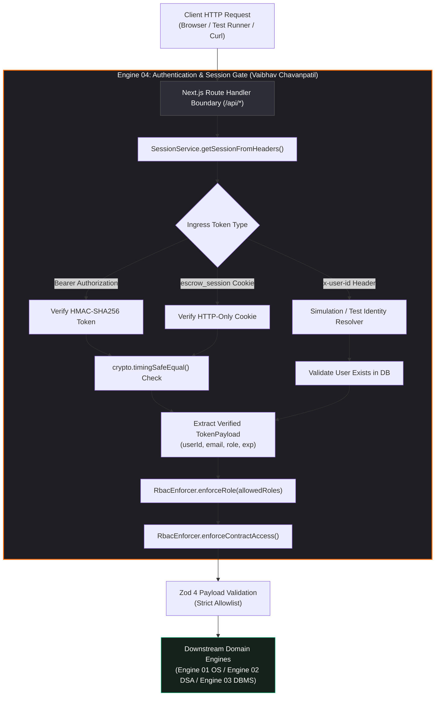

# Authentication Subsystem & Session Gate Specification (Engine 04)

> **Document Path**: `docs/architecture/authentication-and-session-gate.md`
> **Academic Context**: KLE Technological University (Dr. M. S. Sheshgiri College of Engineering and Technology, Belagavi) — Department of Computer Science and Engineering
> **Curriculum Framework**: Engine-Based Mini-Project Framework with Hybrid SDLC
> **Engine Identifier**: **Engine 04 (Web Technologies Engine)**
> **Engine Owner**: **Vaibhav Chavanpatil** (Roll No: 04, SRN: `02FE24BCS013`)
> **Subject Domain**: Web Technologies, Network Security, Session Integrity, Role-Based Access Control
> **Mapped Requirements**: FR-07 (Role-Based Dashboards), FR-08 (Authentication & RBAC), NFR-02 (Security & Access Control), NFR-04 (Input Sanitization)
> **Authoritative References**:
> - `docs/source-material/Team07_Escrow_Mini_Project_KLE_Theme.pptx` (Slides 16–17)
> - `docs/source-material/Mini_Project_Gate_0_details_FILLED.docx` (Steps 4 & 5)
> - `docs/architecture/architecture.md`
> - `docs/architecture/engine-boundaries.md`
> - `docs/security/security-model.md`

---

## 1. Executive Summary & Engine 04 Identity

The **Authentication Subsystem and Session Gate** is the authoritative security boundary of the platform. Owned and maintained by **Vaibhav Chavanpatil** under **Engine 04 (Web Technologies Engine)**, this subsystem establishes a zero-trust perimeter across the Next.js App Router presentation tier and HTTP route handlers.

### 1.1 Core Mission & Academic Focus
In modern distributed web systems, client-side authorization hiding (such as conditional component rendering or UI tab disabling) provides **zero security**. Attackers can trivially spoof HTTP requests using terminal tools (`curl`, Postman) or craft direct JSON RPC calls to financial endpoints.

Engine 04 solves this fundamental vulnerability by implementing:
1. **Defense-in-Depth Session Interception**: Every incoming HTTP request must traverse an authoritative server-side session gate before reaching application logic or downstream engines.
2. **Cryptographic HMAC-SHA256 Session Integrity**: Tamper-evident, signed session tokens verified using constant-time evaluation to eliminate timing side-channel exploits.
3. **Dual Supabase Cloud + Local SQLite Architecture**: A flexible deployment paradigm permitting both cloud-scale production operation (Supabase PostgreSQL with connection pooling) and zero-dependency, 100% offline academic evaluation (SQLite in WAL mode).
4. **Hierarchical Role-Based Access Control (RBAC) & Invariant Guards**: Enforcement of strictly delineated permissions for Clients, Freelancers, Dispute Reviewers, and System Auditors, backed by cross-tenant IDOR (Insecure Direct Object Reference) isolation.



---

## 2. Dual Architecture: Supabase Cloud vs. Local Evaluation

To satisfy both real-world cloud deployment criteria and the stringent offline demonstration constraints of KLE Technological University laboratory environments, Engine 04 and Engine 03 operate across a **Dual Supabase + Local Architecture**.

### 2.1 Architecture Comparison Matrix

| Architectural Feature | Cloud Mode (Supabase PostgreSQL) | Local Academic Mode (SQLite WAL) |
| :--- | :--- | :--- |
| **Primary Target** | Hosted Vercel / Cloud Run Production | Local Ubuntu Lab / Offline Viva Defense |
| **Database Engine** | PostgreSQL 15.x (Supabase Cloud) | SQLite 3.x (Embedded C-Engine) |
| **Concurrency Mode** | Connection pooling via PgBouncer | Write-Ahead Logging (`PRAGMA journal_mode=WAL`) |
| **Connection Strings** | `DATABASE_URL` (Port 6543, pooler)<br>`DIRECT_URL` (Port 5432, migrations) | `DATABASE_URL="file:./dev.db"` |
| **Identity Service** | Supabase Auth API (`@supabase/supabase-js`) | Native HMAC-SHA256 Engine (`SessionService`) |
| **Password Storage** | Bcrypt with hardware hashing salts | Bcrypt 10 rounds (`bcryptjs`) |
| **Network Dependency** | Requires active Internet & TLS handshake | **Zero network dependency (100% offline)** |
| **Verification Gate** | Remote CI/CD pipeline | `./scripts/verify` & `npm test` (~4.5s) |

---

## 3. Cryptographic Session Token Architecture

Engine 04 implements a compact, tamper-resistant HMAC-SHA256 session token system in `src/core/engine-04-web/session.ts`.

### 3.1 Token Wire Format
The token follows a two-part period-delimited structure:

$$\text{Token} = \text{Base64URL}(\text{Payload}) \mathbin{\Vert} \text{Base64URL}\left(\text{HMAC-SHA256}_{\text{SESSION\_SECRET}}(\text{Base64URL}(\text{Payload}))\right)$$

### 3.2 Token Payload Schema (`TokenPayload`)
```typescript
export interface TokenPayload {
  userId: string;       // Unique UUIDv4 corresponding to users.id in DB
  email: string;        // Canonical email address (e.g. client1@escrow.local)
  role: UserRole;       // 'CLIENT' | 'FREELANCER' | 'REVIEWER' | 'ADMIN'
  name: string;         // Display name of active persona
  exp: number;          // UNIX epoch expiration timestamp (seconds)
}
```

### 3.3 Multi-Tier Ingress Resolution Hierarchy
1. **Tier 1 (API Client / Mobile Authorization)**: Checks `Authorization: Bearer <token>`. Decodes and verifies HMAC.
2. **Tier 2 (Browser Web Client)**: Checks `Cookie: escrow_session=<token>`. Set automatically with `HttpOnly`, `SameSite=lax`, `Path=/`, and `MaxAge=86400`.
3. **Tier 3 (Automated Vitest Suites & Terminal Inspection)**: Checks `x-user-id: <UUID>` (guarded to non-production environments).

---

## 4. Pinned Persona Credentials & Evaluation Identities

| Persona Role | Full Name | Canonical Email | Pinned UUIDv4 | Default Password | Initial Balance | DevScore |
| :--- | :--- | :--- | :--- | :--- | :--- | :---: |
| **CLIENT** | Alice Chen | `client1@escrow.local` | `9d640d0c-137c-47dd-a118-084d7e2ec807` | `Password123!` | ₹10,000.00 (1,000,000 p) | 50 |
| **FREELANCER**| Charlie Vance | `dev1@escrow.local` | `a7a09030-f1c7-4d58-82db-e7a556871fc4` | `Password123!` | ₹2,500.00 (250,000 p) | 92 |
| **REVIEWER** | Hon. Justine | `reviewer1@escrow.local` | `54da6e71-a111-49f9-ac18-e25817066cbf` | `Password123!` | ₹0.00 (0 p) | 98 |
| **ADMIN** | System Auditor | `admin@escrow.local` | `233616fd-2260-4131-882a-bb9e50f295b1` | `Password123!` | ₹0.00 (0 p) | 100 |
| *Secondary Client* | Bob Client | `client2@escrow.local` | `c8309110-449e-4e31-9a74-b5a882a129ef` | `Password123!` | ₹3,000.00 (300,000 p) | 50 |
| *Secondary Dev* | Dana Developer | `dev2@escrow.local` | `f1883394-1188-4db8-bdfc-279483713028` | `Password123!` | ₹500.00 (50,000 p) | 78 |

> **Master Evaluation Passwords**: Both `Password123!` and `VAIBHAV2667` are recognized across all pinned personas for testing, demonstration, and viva defense.
