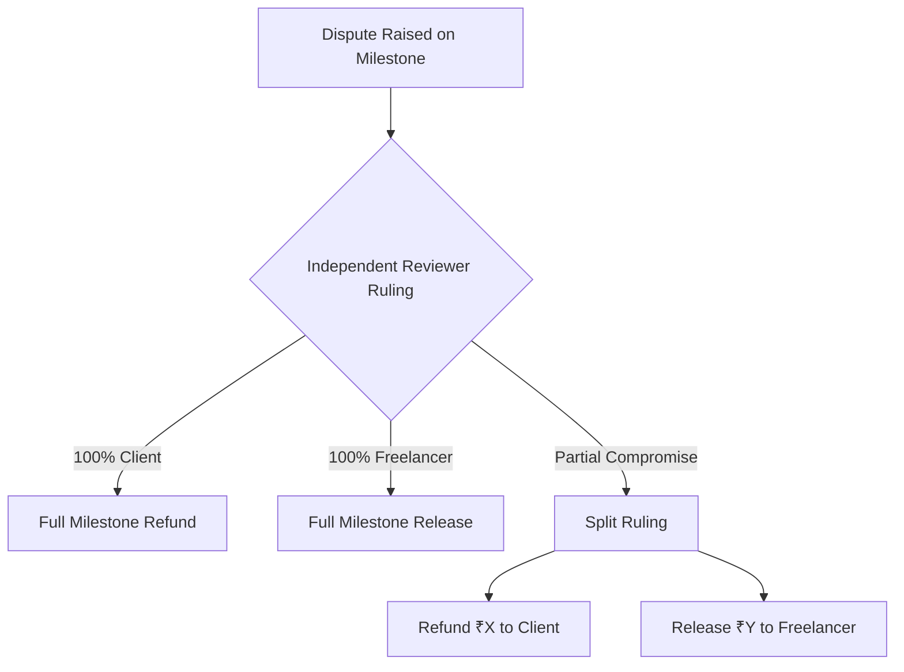
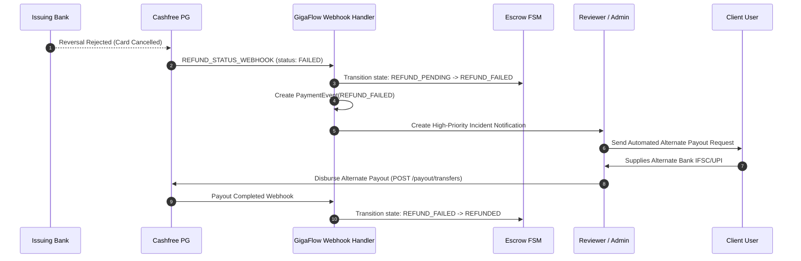
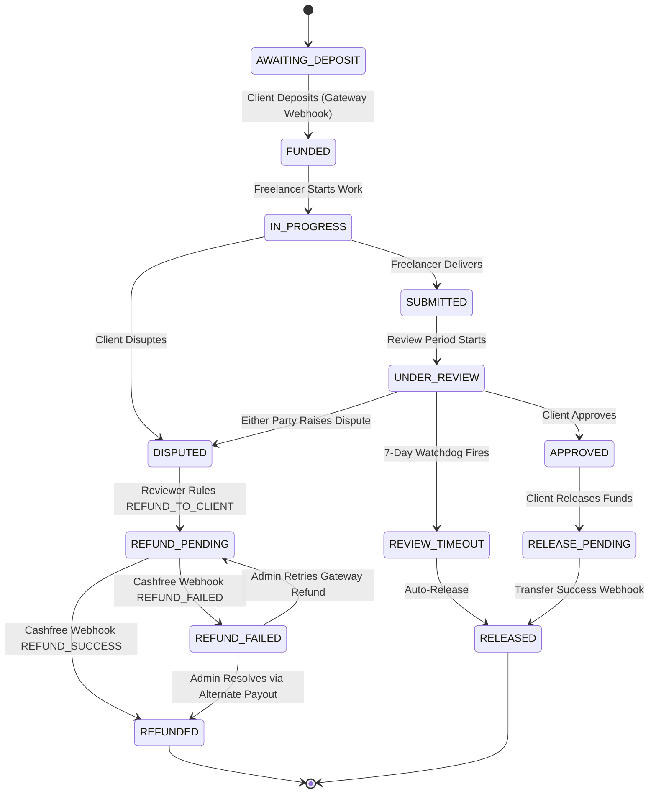
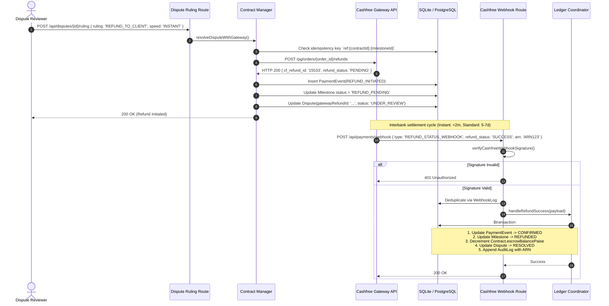

# Cashfree Refunds & Dispute Reversals Architecture

## 1. Executive Summary

This specification defines the exact API contracts, cryptographic protocols, error handling models, and state machine updates required in GigaFlow when an evidence-based dispute concludes with a financial refund or reversal to the client via Cashfree Payment Gateway (v2023-08-01 / v2022-09-01).

In GigaFlow's simulated implementation, dispute resolution executes synchronous, in-memory ledger mutations (`Contract.escrowBalance -= amount; User.balance += amount`). In production, **GigaFlow operates as a non-custodial Technology Service Provider (TSP)**. All escrow funds reside in Cashfree's RBI-regulated Payment Aggregator (PA) nodal/escrow accounts. Refunds are asynchronous banking events subject to interbank settlement cycles (T+5 to T+7 business days or T+0 instant routing), card network limitations, and bank account state changes.

---

## 2. Cashfree Refund API Specification

### 2.1 Endpoint Overview

| Action | HTTP Method | Endpoint | Description |
|---|---|---|---|
| **Create Refund** | `POST` | `/pg/orders/{order_id}/refunds` | Initiates full or partial refund against an order |
| **Get Refund** | `GET` | `/pg/orders/{order_id}/refunds/{refund_id}` | Retrieves status and banking details (ARN) of a refund |
| **List Refunds** | `GET` | `/pg/orders/{order_id}/refunds` | Retrieves all refunds initiated against an order |

### 2.2 Standard Request Headers

```http
POST /pg/orders/{order_id}/refunds HTTP/1.1
Host: sandbox.cashfree.com (or api.cashfree.com for production)
Content-Type: application/json
x-api-version: 2023-08-01
x-client-id: <CASHFREE_APP_ID>
x-client-secret: <CASHFREE_SECRET_KEY>
x-idempotency-key: <UUIDv4>
```

### 2.3 Create Refund (`POST /pg/orders/{order_id}/refunds`)

#### Request Schema & Field Constraints

```typescript
export interface CashfreeCreateRefundRequest {
  /** Unique merchant identifier for the refund (max 40 chars, [a-zA-Z0-9_-]) */
  refund_id: string;

  /** Total refund amount in INR with up to 2 decimal places (converted from paise) */
  refund_amount: number;

  /** Short reason or note regarding the refund for audit & customer receipt (max 250 chars) */
  refund_note?: string;

  /** Execution rail: "STANDARD" (banking days) or "INSTANT" (instant credit via IMPS/UPI) */
  refund_speed?: 'STANDARD' | 'INSTANT';

  /**
   * Vendor split debit directives when using Cashfree Easy Split (Marketplace).
   * Dictates how the refund is recovered from onboarded freelancers/sub-merchants.
   */
  refund_splits?: Array<{
    /** Registered Cashfree vendor ID of the freelancer */
    vendor_id: string;
    /** Amount to debit from this vendor's balance */
    amount: number;
    /** Alternative: percentage to debit */
    percentage?: number;
  }>;

  /** Optional custom key-value metadata for GigaFlow internal correlation */
  metadata?: Record<string, string>;
}
```

#### Request Payload Example (Partial Dispute Ruling with Easy Split)

```json
{
  "refund_id": "ref_cntr_4c9b_m2_disp_01",
  "refund_amount": 2500.00,
  "refund_note": "Dispute Ruling #DISP-9102: Milestone 2 Defective Deliverable Refund",
  "refund_speed": "INSTANT",
  "refund_splits": [
    {
      "vendor_id": "vnd_freelancer_789",
      "amount": 2500.00
    }
  ],
  "metadata": {
    "contract_id": "4c9b1b70-7164-4e4b-9c60-84a441364582",
    "milestone_id": "m2_8192a_90f",
    "dispute_id": "disp_9102_xyz",
    "reviewer_id": "usr_rev_301"
  }
}
```

#### Synchronous Response Schema (`HTTP 200 OK` / `HTTP 201 Created`)

```typescript
export interface CashfreeRefundResponse {
  /** Cashfree internal transaction identifier for the original payment */
  cf_payment_id: number;

  /** Cashfree unique identifier for the refund */
  cf_refund_id: string;

  /** Merchant provided unique refund ID */
  refund_id: string;

  /** Parent Cashfree Order ID */
  order_id: string;

  /** Entity type: always "refund" */
  entity: 'refund';

  /** Refunded amount in INR */
  refund_amount: number;

  /** Currency code: "INR" */
  refund_currency: string;

  /** Merchant refund note */
  refund_note: string;

  /** Current processing state of the refund */
  refund_status: 'SUCCESS' | 'PENDING' | 'ONHOLD' | 'FAILED';

  /** Origin of refund initiation */
  refund_type: 'MERCHANT_INITIATED' | 'SYSTEM_AUTO_REFUND';

  /** Split breakdowns if Easy Split was utilized */
  refund_splits: Array<{
    vendor_id: string;
    amount: number;
    percentage?: number;
  }>;

  /** Human/machine-readable description of current status */
  status_description: string;

  /**
   * Acquiring Reference Number (ARN) provided by card/banking network.
   * Null until banking processing reaches final clearing stage.
   */
  refund_arn: string | null;

  /** Key-value metadata */
  metadata: Record<string, string> | null;

  /** ISO 8601 creation timestamp */
  created_at: string;

  /** ISO 8601 completion timestamp (null if PENDING) */
  processed_at: string | null;

  /** Gateway processing fee incurred for the refund (e.g. for INSTANT mode) */
  refund_charge: number;

  /** Actual execution mode used */
  refund_mode: 'STANDARD' | 'INSTANT';
}
```

#### Synchronous Response Example

```json
{
  "cf_payment_id": 918812450,
  "cf_refund_id": "refund_155333890",
  "refund_id": "ref_cntr_4c9b_m2_disp_01",
  "order_id": "order_cntr_4c9b1b70",
  "entity": "refund",
  "refund_amount": 2500.00,
  "refund_currency": "INR",
  "refund_note": "Dispute Ruling #DISP-9102: Milestone 2 Defective Deliverable Refund",
  "refund_status": "PENDING",
  "refund_type": "MERCHANT_INITIATED",
  "refund_splits": [
    {
      "vendor_id": "vnd_freelancer_789",
      "amount": 2500.00
    }
  ],
  "status_description": "Refund initiated and pending banking settlement",
  "refund_arn": null,
  "metadata": {
    "contract_id": "4c9b1b70-7164-4e4b-9c60-84a441364582",
    "milestone_id": "m2_8192a_90f"
  },
  "created_at": "2026-10-03T10:15:30+05:30",
  "processed_at": null,
  "refund_charge": 0.00,
  "refund_mode": "INSTANT"
}
```

### 2.4 Fetch Refund Status (`GET /pg/orders/{order_id}/refunds/{refund_id}`)

Used for active polling, timeout watchdogs, and reconciliation:

```http
GET /pg/orders/order_cntr_4c9b1b70/refunds/ref_cntr_4c9b_m2_disp_01 HTTP/1.1
Host: sandbox.cashfree.com
x-api-version: 2023-08-01
x-client-id: <CASHFREE_APP_ID>
x-client-secret: <CASHFREE_SECRET_KEY>
```

Returns the identical `CashfreeRefundResponse` entity. Once the acquiring bank clears the reversal, `refund_status` becomes `"SUCCESS"`, `refund_arn` is populated (e.g., `"123456789012"`), and `processed_at` contains the settlement timestamp.

---

## 3. Webhook Events & Cryptographic Signature Verification

### 3.1 Webhook Event Architecture

Cashfree notifies GigaFlow asynchronously when the status of a refund changes. The unified webhook event for refunds is **`REFUND_STATUS_WEBHOOK`**.

| `refund_status` Value | Functional Meaning | GigaFlow Action |
|---|---|---|
| **`SUCCESS`** | Bank credited funds to client source account | Mark Milestone `REFUNDED`, debit Contract escrow, close dispute |
| **`FAILED`** | Issuing bank rejected the refund transaction | Mark Milestone `REFUND_FAILED`, alert Admin for manual payout |
| **`PENDING`** | Still undergoing clearance in ACH/clearing house | Maintain Milestone in `REFUND_PENDING` |
| **`CANCELLED`** | Refund cancelled by merchant before processing | Revert Milestone to `DISPUTED` |
| **`ONHOLD`** | Cashfree risk or compliance hold | Trigger internal compliance alert |

### 3.2 Webhook Payload Schemas

#### A. Refund Success Payload (`REFUND_STATUS_WEBHOOK` with `SUCCESS`)

```json
{
  "data": {
    "refund": {
      "cf_payment_id": 918812450,
      "cf_refund_id": "refund_155333890",
      "refund_id": "ref_cntr_4c9b_m2_disp_01",
      "order_id": "order_cntr_4c9b1b70",
      "refund_amount": 2500.00,
      "refund_currency": "INR",
      "refund_note": "Dispute Ruling #DISP-9102: Milestone 2 Defective Deliverable Refund",
      "refund_status": "SUCCESS",
      "status_description": "Refund processed successfully",
      "refund_arn": "ARN2026100391881245",
      "created_at": "2026-10-03T10:15:30+05:30",
      "processed_at": "2026-10-03T10:17:12+05:30",
      "refund_charge": 5.00,
      "refund_mode": "INSTANT",
      "refund_splits": [
        {
          "vendor_id": "vnd_freelancer_789",
          "amount": 2500.00
        }
      ]
    }
  },
  "event_time": "2026-10-03T10:17:13+05:30",
  "type": "REFUND_STATUS_WEBHOOK"
}
```

#### B. Refund Failed Payload (`REFUND_STATUS_WEBHOOK` with `FAILED`)

```json
{
  "data": {
    "refund": {
      "cf_payment_id": 918812450,
      "cf_refund_id": "refund_155333890",
      "refund_id": "ref_cntr_4c9b_m2_disp_01",
      "order_id": "order_cntr_4c9b1b70",
      "refund_amount": 2500.00,
      "refund_currency": "INR",
      "refund_note": "Dispute Ruling #DISP-9102: Milestone 2 Defective Deliverable Refund",
      "refund_status": "FAILED",
      "status_description": "Customer account closed or frozen by beneficiary bank",
      "refund_arn": null,
      "created_at": "2026-10-03T10:15:30+05:30",
      "processed_at": "2026-10-03T10:16:05+05:30",
      "refund_charge": 0.00,
      "refund_mode": "STANDARD",
      "error_details": {
        "error_code": "BENEFICIARY_ACCOUNT_CLOSED",
        "error_description": "Account does not accept credits",
        "error_reason": "BANK_REJECTION"
      }
    }
  },
  "event_time": "2026-10-03T10:16:06+05:30",
  "type": "REFUND_STATUS_WEBHOOK"
}
```

### 3.3 Cryptographic Signature Verification Protocol

To prevent spoofing and replay attacks, Cashfree signs all webhook deliveries with HMAC-SHA256:

1. **Header Inspection**: Cashfree supplies headers:
   - `x-webhook-timestamp`: Request dispatch timestamp.
   - `x-webhook-signature`: Base64-encoded HMAC-SHA256 hash.
2. **Payload Concatenation**:
   $$\text{SignaturePayload} = \text{timestamp} + \text{rawBody}$$
   *Crucial rule*: `rawBody` must be the verbatim, unparsed UTF-8 byte stream received over HTTP. Any whitespace normalization or JSON re-serialization will invalidate the signature.
3. **Replay Tolerance Window**:
   Reject any payload where:
   $$|\text{CurrentTime} - \text{timestamp}| > 300\,000\text{ ms (5 minutes)}$$
4. **Timing-Safe Comparison**:
   Use constant-time equality check (`crypto.timingSafeEqual`) to prevent byte-by-byte timing attacks.

#### Production Implementation (`src/lib/cashfree-verifier.ts`)

```typescript
import crypto from 'crypto';

export interface VerifyWebhookResult {
  isValid: boolean;
  reason?: string;
}

export function verifyCashfreeWebhookSignature(
  rawBody: string,
  timestampHeader: string | null,
  signatureHeader: string | null,
  webhookSecret: string
): VerifyWebhookResult {
  if (!timestampHeader || !signatureHeader) {
    return { isValid: false, reason: 'Missing timestamp or signature headers' };
  }

  // 1. Replay attack verification (5-minute drift window)
  const timestamp = Number(timestampHeader);
  const now = Date.now();
  if (isNaN(timestamp) || Math.abs(now - timestamp) > 5 * 60 * 1000) {
    return { isValid: false, reason: 'Webhook timestamp outside allowed 5-minute tolerance window' };
  }

  // 2. Concatenate timestamp + rawBody
  const signaturePayload = timestampHeader + rawBody;

  // 3. Generate expected HMAC-SHA256 Base64 hash
  const expectedSignature = crypto
    .createHmac('sha256', webhookSecret)
    .update(signaturePayload)
    .digest('base64');

  // 4. Constant-time buffer comparison
  const expectedBuffer = Buffer.from(expectedSignature, 'utf8');
  const receivedBuffer = Buffer.from(signatureHeader, 'utf8');

  if (expectedBuffer.length !== receivedBuffer.length) {
    return { isValid: false, reason: 'Signature length mismatch' };
  }

  const matches = crypto.timingSafeEqual(expectedBuffer, receivedBuffer);
  return matches
    ? { isValid: true }
    : { isValid: false, reason: 'Cryptographic signature mismatch' };
}
```

---

## 4. Partial vs. Full Refunds in Disputes

### 4.1 Dispute Ruling Scenarios

In GigaFlow, an evidence-based dispute can conclude with one of three monetary rulings:



1. **Full Refund to Client (`REFUND_TO_CLIENT`)**:
   - Deliverable declared completely non-functional or unsubmitted.
   - 100% of the milestone funds held in escrow are refunded to the client's original payment method.
2. **Full Release to Freelancer (`RELEASE_TO_FREELANCER`)**:
   - Freelancer proved contract requirements were fully satisfied via SHA-256 evidence.
   - 100% of milestone funds are settled to the freelancer's vendor account via Easy Split.
3. **Split Ruling (`SPLIT_AWARD`)**:
   - The reviewer rules that partial work has value (e.g. ₹6,000 to client refund, ₹4,000 to freelancer release on a ₹10,000 milestone).
   - **Monetary Invariant**:
     $$\text{ClientRefundAmount} + \text{FreelancerReleaseAmount} = \text{MilestoneEscrowAmount}$$
   - Executed as two coordinated gateway calls:
     1. Gateway Call A: `POST /pg/orders/{order_id}/refunds` for `ClientRefundAmount` with `refund_splits` debiting the vendor.
     2. Gateway Call B: Easy Split release / transfer for `FreelancerReleaseAmount`.

### 4.2 Order Structuring: Single Order vs. Milestone-Per-Order

GigaFlow supports two payment deposit topologies:

| Architecture Model | Description | How Partial Milestone Refunds Work |
|---|---|---|
| **Model A: Order per Milestone** | Client creates a distinct Cashfree Order for each milestone deposit (`order_cntr_{id}_m1`, `order_cntr_{id}_m2`). | Full milestone refund = 100% order refund. Partial milestone refund = partial refund of that milestone's specific order. Simple, isolated tracing. |
| **Model B: Single Order for Contract** | Client funds the entire project at once (`order_cntr_{id}`). Milestones draw from this total deposit. | Milestone 1 refund, Milestone 2 refund, etc. are processed as **multiple partial refunds** against the parent `order_id`. Cashfree enforces that $\sum \text{refund\_amount} \le \text{order\_amount}$. |

> [!TIP]
> **Recommended Production Pattern**: Model A (Order per Milestone) provides strict cryptographic and transactional isolation. Each milestone maintains its own distinct `gatewayOrderId` and idempotency domain.

### 4.3 Cashfree Easy Split (Marketplace) Mechanics in Disputes

When funds are captured with Easy Split, the transaction is tagged with vendor splits:

1. **Pre-Settlement Dispute (Ideal Path)**:
   - When the client raised the dispute, the milestone remained locked in `DISPUTED` state, preventing vendor settlement.
   - When the refund is triggered, Cashfree debits the vendor's pending split balance before funds ever leave Cashfree PA accounts.
   - No bank clawback is required.
2. **Post-Settlement Dispute (Edge Path)**:
   - If funds were prematurely settled or if a milestone was contested post-release:
   - Cashfree debits the platform's merchant nodal settlement account.
   - A negative balance is applied to the vendor's Cashfree account, automatically recovered from their subsequent milestone earnings.
   - *Failure Guard*: If the split has already been finalized and locked by bank clearing, the API returns `409 split_already_finalized`. In this case, GigaFlow triggers manual dispute arbitration or adjustment.

---

## 5. Instant Refunds vs. Standard Banking Reversal Timelines

### 5.1 Comparative Architecture Matrix

| Parameter | Standard Reversal (`STANDARD`) | Instant Refund (`INSTANT`) |
|---|---|---|
| **Settlement Timeline** | **5 to 7 Business Days** (up to 10 days for Net Banking) | **Minutes** (typically < 120 seconds) |
| **Routing Mechanism** | Clearing house reversal batch files, card chargeback processing (Visa Direct, Mastercard Send, NACH/ACH) | Immediate interbank transfer via direct UPI rail or IMPS payout rails to customer source VPA/account |
| **Fee Structure** | Included in standard gateway processing charges (₹0 extra) | Nominal transaction fee (typically ₹2 - ₹5 charged to merchant) |
| **Supported Methods** | All payment methods (Cards, UPI, Net Banking, Wallets) | UPI, major bank Debit/Credit cards, select Net Banking |
| **Customer Experience** | Slow; leads to client inquiries and anxiety during dispute | Immediate resolution; builds platform trust upon dispute win |
| **Availability Window** | Available for transactions up to 180 days old | Highly reliant on active partner bank IMPS uptime |

### 5.2 Automatic Fallback Behavior

When GigaFlow requests `refund_speed: "INSTANT"`, Cashfree evaluates channel health:
1. If the issuing bank or payment instrument does not support instant reversals (or if the bank's IMPS switch is temporarily offline), **Cashfree automatically downgrades the refund to `STANDARD`**.
2. The refund response will return `refund_mode: "STANDARD"`, and `refund_status: "PENDING"`.
3. GigaFlow's UI notifies the client: *"Instant refund unavailable for your bank; standard reversal initiated (5-7 business days)."*

---

## 6. Handling Refund Failures & Edge Cases

### 6.1 Why Real Banking Refunds Fail

Unlike database rollbacks, banking reversals can fail due to real-world financial conditions:

```
┌────────────────────────────────────────────────────────────────────────┐
│                        REFUND FAILURE MODES                            │
├─────────────────────────────┬──────────────────────────────────────────┤
│ Cause                       │ Error Code / Description                 │
├─────────────────────────────┼──────────────────────────────────────────┤
│ Account Closed / Suspended  │ BENEFICIARY_ACCOUNT_CLOSED / DORMANT     │
│ Expired / Cancelled Card    │ CARD_EXPIRED / CARD_CANCELLED            │
│ Beneficiary Bank System Out │ BEN_BANK_OFFLINE / TIMEOUT               │
│ Daily Limit Reached         │ BENEFICIARY_LIMIT_EXCEEDED               │
│ Refund Window Expired       │ REFUND_WINDOW_EXPIRED (> 180 days)       │
│ Insufficient Nodal Balance  │ INSUFFICIENT_MERCHANT_BALANCE            │
└─────────────────────────────┴──────────────────────────────────────────┘
```

### 6.2 Cashfree's Native Retry Policy

- For transient network or interbank timeouts, Cashfree automatically retries the refund up to **3 times** over a 24-hour cycle before marking it `FAILED`.
- While retries are active, `refund_status` remains `PENDING`.
- If all attempts are exhausted, Cashfree sends `REFUND_STATUS_WEBHOOK` with `refund_status: "FAILED"`.

### 6.3 GigaFlow Non-Custodial Failure Recovery Protocol

When Cashfree emits `refund_status: "FAILED"`, GigaFlow must **never silently drop the transaction or trap funds in limbo**:



1. **FSM Transition**: Milestone transitions from `REFUND_PENDING` to `REFUND_FAILED`.
2. **Funds Safety**: The funds remain safe inside Cashfree's nodal escrow pool; they are neither with the freelancer nor the client.
3. **Automated Alerting**: System dispatches a `DISCREPANCY` alert to the Admin dashboard and logs an immutable `AuditLog` entry.
4. **Out-of-Band Disbursal (Cashfree Payout Links)**:
   - GigaFlow invokes the Cashfree Payouts API (`POST /payout/links`) to generate a secure payout link sent to the client's verified email/SMS.
   - The client enters their updated bank account number and IFSC or UPI VPA.
   - Funds are disbursed directly from Cashfree nodal accounts to the verified destination, completing the refund without merchant custody.

---

## 7. Cashfree API Error Codes Reference

### 7.1 HTTP Status Codes & Sub-Codes

| HTTP Code | Error Sub-Code (`code`) | Reason & Handling |
|---|---|---|
| **400** | `order_not_paid` | Order was never completed; no funds exist to refund. |
| **400** | `refund_amount_exceeded` | Requested refund amount exceeds remaining refundable balance on the order. |
| **400** | `refund_window_expired` | More than 180 days have elapsed since transaction. Manual payout required. |
| **400** | `invalid_request` | Malformed JSON, missing mandatory fields (`refund_id`, `refund_amount`). |
| **401** | `authentication_error` | Missing or invalid `x-client-id` / `x-client-secret`. Check environment variables. |
| **404** | `order_not_found` | `order_id` does not exist in Cashfree environment. |
| **404** | `refund_not_found` | `refund_id` queried via GET does not exist. |
| **409** | `duplicate_refund_id` | A refund with this `refund_id` was already initiated. Return existing receipt. |
| **409** | `split_already_finalized` | Vendor split was already cleared by banking system; cannot debit split directly. |
| **422** | `insufficient_merchant_balance`| Platform nodal account lacks balance to cover post-settlement debit. |
| **429** | `rate_limit_error` | Too many requests. Implement exponential backoff with jitter. |
| **500 / 502** | `internal_error` | Gateway or bank-side failure. Retry with identical `x-idempotency-key`. |

---

## 8. GigaFlow Escrow FSM Updates

### 8.1 Shortcomings of Current Implementation

The current `EscrowFsmValidator` (`src/core/engine-01-os/escrow-fsm.ts`) contains a synchronous assumption:
```typescript
{
  from: 'DISPUTED',
  action: 'RESOLVE_REFUND',
  allowedRoles: ['REVIEWER'],
  to: 'REFUNDED', // IMMEDIATE TERMINAL JUMP!
}
```
In real banking, executing a refund takes between 2 minutes and 7 days, and can fail. If GigaFlow marks a milestone `REFUNDED` immediately, and the banking transaction fails 3 days later, the database has lost sync with banking reality.

### 8.2 Production State Machine



### 8.3 FSM Transition Rule Table Updates

| From State | Action | Allowed Roles | To State | Description |
|---|---|---|---|---|
| `DISPUTED` | `RESOLVE_REFUND_INITIATE` | `REVIEWER`, `ADMIN` | `REFUND_PENDING` | Reviewer issues binding ruling; calls Cashfree refund API. |
| `DISPUTED` | `RESOLVE_RELEASE_INITIATE` | `REVIEWER`, `ADMIN` | `RELEASE_PENDING` | Reviewer issues binding ruling; calls Cashfree vendor split payout. |
| `REFUND_PENDING` | `CONFIRM_REFUND_WEBHOOK` | `SYSTEM` | `REFUNDED` | Verified webhook confirms banking settlement. **Terminal State.** |
| `REFUND_PENDING` | `FAIL_REFUND_WEBHOOK` | `SYSTEM` | `REFUND_FAILED` | Verified webhook reports bank rejection. Requires human intervention. |
| `REFUND_FAILED` | `RETRY_REFUND` | `ADMIN` | `REFUND_PENDING` | Administrator retries refund with updated parameters. |
| `REFUND_FAILED` | `MANUAL_PAYOUT_RESOLVED` | `ADMIN` | `REFUNDED` | Administrator completes out-of-band disbursement via Payout Link. |

---

## 9. Database Schema Modifications (Prisma)

### 9.1 Milestone & Dispute Schema Enhancements

```prisma
model Milestone {
  id             String    @id @default(uuid())
  contractId     String    @map("contract_id")
  title          String
  description    String
  amountPaise    Int       @map("amount_paise") // Migrated from Float
  sequenceOrder  Int       @map("sequence_order")
  // State machine: PENDING | FUNDED | IN_PROGRESS | SUBMITTED | UNDER_REVIEW | APPROVED | DISPUTED | RELEASE_PENDING | RELEASED | REFUND_PENDING | REFUND_FAILED | REFUNDED
  status         String    @default("PENDING")
  dueDate        DateTime  @map("due_date")
  reviewDeadline DateTime? @map("review_deadline")
  gatewayOrderId String?   @map("gateway_order_id")
  createdAt      DateTime  @default(now()) @map("created_at")
  updatedAt      DateTime  @updatedAt @map("updated_at")

  contract           Contract            @relation(fields: [contractId], references: [id])
  deliverable        Deliverable?
  dispute            Dispute?
  paymentEvents      PaymentEvent[]
  escrowTransactions EscrowTransaction[]

  @@unique([contractId, sequenceOrder])
  @@index([contractId])
  @@index([status])
  @@map("milestones")
}

model Dispute {
  id                 String    @id @default(uuid())
  milestoneId        String    @unique @map("milestone_id")
  raisedById         String    @map("raised_by_id")
  reviewerId         String?   @map("reviewer_id")
  reason             String
  status             String    @default("OPEN") // OPEN | UNDER_REVIEW | RESOLVED | REJECTED
  ruling             String?   // RELEASE_TO_FREELANCER | REFUND_TO_CLIENT | SPLIT_AWARD
  rulingNotes        String?   @map("ruling_notes")

  // Real gateway refund tracking
  gatewayRefundId    String?   @map("gateway_refund_id")
  cfRefundId         String?   @map("cf_refund_id")
  refundStatus       String?   @map("refund_status") // PENDING | SUCCESS | FAILED
  refundAmountPaise  Int?      @map("refund_amount_paise")
  refundSpeed        String?   @map("refund_speed")  // STANDARD | INSTANT
  refundArn          String?   @map("refund_arn")
  failureReason      String?   @map("failure_reason")

  createdAt          DateTime  @default(now()) @map("created_at")
  resolvedAt         DateTime? @map("resolved_at")

  milestone     Milestone         @relation(fields: [milestoneId], references: [id])
  raisedBy      User              @relation("DisputesRaised", fields: [raisedById], references: [id])
  reviewer      User?             @relation("DisputesReviewed", fields: [reviewerId], references: [id])
  evidenceItems DisputeEvidence[]

  @@index([status])
  @@index([gatewayRefundId])
  @@map("disputes")
}
```

### 9.2 Append-Only PaymentEvent Ledger

```prisma
model PaymentEvent {
  id               String   @id @default(uuid())
  contractId       String   @map("contract_id")
  milestoneId      String?  @map("milestone_id")
  type             String   // ORDER_CREATED | PAYMENT_CAPTURED | REFUND_INITIATED | REFUND_COMPLETED | REFUND_FAILED
  gatewayOrderId   String?  @map("gateway_order_id")
  gatewayPaymentId String?  @map("gateway_payment_id")
  gatewayRefundId  String?  @map("gateway_refund_id")
  cfRefundId       String?  @map("cf_refund_id")
  idempotencyKey   String   @unique @map("idempotency_key")
  amountPaise      Int      @map("amount_paise")
  currency         String   @default("INR")
  status           String   // INITIATED | CONFIRMED | FAILED
  gatewayResponse  String?  @map("gateway_response") // Full raw JSON
  actorId          String   @map("actor_id")
  createdAt        DateTime @default(now()) @map("created_at")

  contract  Contract   @relation(fields: [contractId], references: [id])
  milestone Milestone? @relation(fields: [milestoneId], references: [id])

  @@index([contractId, type])
  @@index([gatewayRefundId])
  @@index([idempotencyKey])
  @@map("payment_events")
}
```

---

## 10. End-to-End Execution Sequence Diagram



---

## 11. Testing & Verification Guide

### 11.1 Cashfree Sandbox Simulation Scenarios

In Cashfree PG Sandbox (`https://sandbox.cashfree.com/pg`), refund events can be simulated with specific test parameters:

1. **Immediate Refund Success Simulation**:
   - Order ID with successful simulation token triggers `refund_status: "SUCCESS"` within 60 seconds.
2. **Refund Failure Simulation**:
   - Passing `refund_amount` with `.99` (e.g. `2500.99`) in sandbox environment triggers simulated bank rejection (`BENEFICIARY_ACCOUNT_CLOSED`).
3. **Webhook Verification Test**:
   - Verify that modifying 1 byte in the JSON payload triggers `Signature length mismatch` or `Cryptographic signature mismatch` with HTTP 401.
4. **Idempotency Guard Test**:
   - Repeating identical `POST /pg/orders/{order_id}/refunds` with same `refund_id` returns HTTP 409 `duplicate_refund_id` or existing receipt without double debit.
