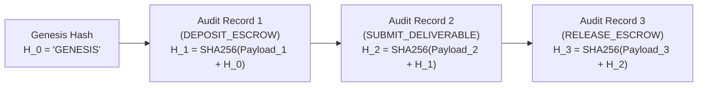
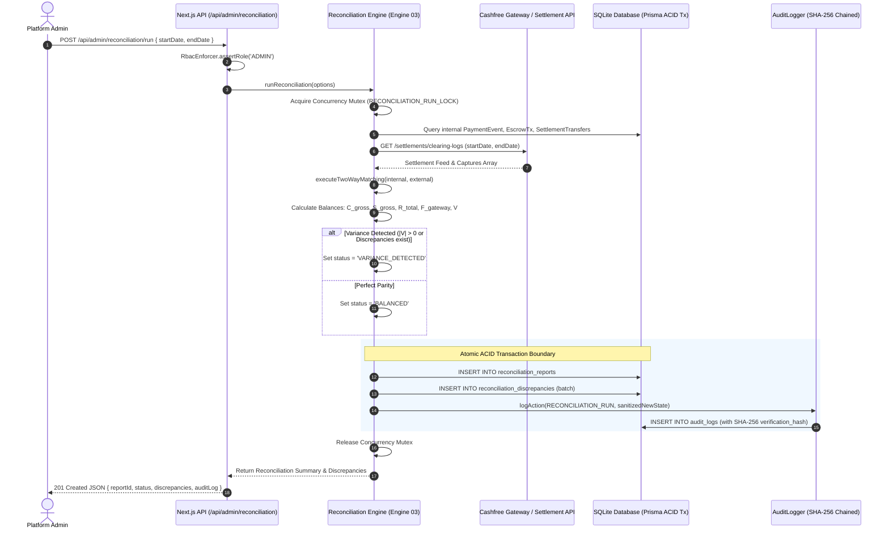

# Payment Reconciliation Engine & Tamper-Resistant Audit Logging Architecture

> **Document Type**: Production Architecture Specification  
> **System Component**: Engine 03 (DBMS Engine) & Cross-Engine Security Architecture  
> **Engine Owner**: Purvi Sammatshetti (Roll No: 11, SRN: `02FE24BCS022`)  
> **Collaborators**: Vaishnavi Modekar (Engine 01), Darshan Kittur (Engine 02), Vaibhav Chavanpatil (Engine 04)  
> **Institution**: KLE Technological University, Dr. M. S. Sheshgiri College of Engineering & Technology, Belagavi  
> **Department**: Computer Science and Engineering (Team 07, Theme 01)  
> **Related Documents**:
> - `docs/architecture/real-payment-architecture.md` (Real Payment Gateway Architecture)
> - `docs/decisions/ADR-011-real-payment-gateway.md` (Gateway Selection ADR)
> - `docs/database/audit-log-design.md` (Authoritative Audit Log Design)
> - `docs/database/transaction-design.md` (ACID Transaction Boundaries)
> - `docs/database/schema.md` (BCNF Schema Specification)

---

## 1. Executive Summary & Problem Formulation

In a milestone-based freelance escrow system (GigaFlow), money movements occur across two asynchronously coupled planes:
1. **The Internal State Ledger (Engine 03)**: Relational BCNF tables (`contracts`, `milestones`, `escrow_transactions`, `audit_logs`) running inside SQLite WAL mode transactions.
2. **The External Payment Infrastructure (Cashfree Payment Gateway & Cashfree Payouts)**: Regulated Payment Aggregator (PA) holding nodal escrow accounts, receiving client fiat deposits, and executing automated IMPS/NEFT transfers to freelancer bank accounts.

Because banking systems operate on asynchronous clearing cycles (T+1 / T+2 settlement, batch clearing, bank network timeouts, delayed webhooks, and manual bank reversals), the internal ledger and external gateway balance inevitably diverge in real time.

```
+---------------------------------------------------------------------------------------------------+
|                                      GigaFlow System Boundary                                     |
|                                                                                                   |
|  [Client Webhook] ---> [PaymentEvent Store] ---> [LedgerCoordinator] ---> [EscrowTransaction]     |
|                               (Engine 03)             (ACID Tx)               (Double Entry)      |
|                                                                                      |            |
|  [Freelancer Payout] <- [SettlementTransfer] <--- [Milestone Release] <--------------+            |
+----------------------------------------+----------------------------------------------------------+
                                         |
                       Two-Way Reconciliation Engine
                                         |
+----------------------------------------+----------------------------------------------------------+
|                                    Cashfree Payment Infrastructure                                |
|                                                                                                   |
|  [Cashfree Orders / Payments API]                      [Cashfree Settlements API / Clearing Files]|
|  [Cashfree Payouts / Transfers API]                    [Webhook Notifications (HMAC-SHA256)]      |
+---------------------------------------------------------------------------------------------------+
```

### Core Responsibilities of this Architecture
1. **Two-Way Reconciliation Engine (Engine 03)**: Compare internal records (`PaymentEvents`, `EscrowTransactions`, `SettlementTransfers`, `Refunds`) against Cashfree's daily settlement and payment clearing reports.
2. **Financial Balance & Conservation Tracking**: Formulate and compute Total Collected (INR / GF), Total Settled, Total Refunded, Gateway Fees, and Net Escrow Balance.
3. **Discrepancy Identification**: Detect and categorize anomalies into Unreconciled Payments (Ghost captures vs Zombie captures), Orphaned Webhooks, Stuck Transfers (T+2 SLA breach), and Amount/Fee Mismatches.
4. **Administrative Controls**: Expose `GET /api/admin/reconciliation` and `POST /api/admin/reconciliation/run` for automated and on-demand reconciliation.
5. **Tamper-Resistant Audit Trail**: Maintain an immutable SHA-256 Merkle-Damgård chained audit trail incorporating external provider references (`providerOrderId`, `providerPaymentId`, `providerTransferId`) while guaranteeing **Zero Secrets and Zero PAN/Card numbers** in persistent storage.

---

## 2. Ingestion Pipeline & Clearing Mapping

The reconciliation engine ingests two distinct data streams: internal event-sourced transaction entries and external clearing records downloaded via Cashfree's Settlement API or daily batch export files.

### 2.1 Entity Mapping Matrix

| Domain Dimension | Internal GigaFlow Entity | External Cashfree Entity / Feed | Matching Key(s) | Tolerance / Invariant |
| :--- | :--- | :--- | :--- | :--- |
| **Client Deposits** | `PaymentEvent` (type: `PAYMENT_CAPTURED`) & `EscrowTransaction` (type: `DEPOSIT`) | Cashfree Payments API / Settlement Feed (`cf_payment_id`, `order_id`, `payment_status`) | `order_id` (UUID), `cf_payment_id` | Exact amount match ($\Delta = 0$ paise); Currency: INR |
| **Freelancer Payouts** | `SettlementTransfer` (type: `PAYOUT_DISBURSED`) & `EscrowTransaction` (type: `RELEASE`) | Cashfree Payouts / Transfers API (`cf_transfer_id`, `transfer_id`, `utr`, `status`) | `transfer_id` (Internal UUID), `cf_transfer_id`, `utr` | Exact amount match; Bank UTR verification |
| **Dispute Refunds** | `Refund` & `EscrowTransaction` (type: `REFUND`) | Cashfree Refunds API (`cf_refund_id`, `refund_id`, `refund_status`) | `refund_id`, `cf_refund_id`, `order_id` | Exact amount match |
| **Gateway Fees & Tax** | Contract Fee Allocation Model (`fee_breakdown`) | Cashfree Daily Settlement Log (`service_charge`, `service_tax`, `settlement_id`) | `settlement_id`, `cf_payment_id` | Floating round-off tolerance $\le \pm \text{INR } 0.01$ |
| **Incoming Webhooks** | `WebhookLog` (raw payloads) | Cashfree Webhook Event Logs | `event_id`, `gateway_event_id` | Cryptographic signature validity (`signature_valid = true`) |

---

## 3. Financial Balance Formulas & Conservation Invariants

### 3.1 Accounting Units
- **Platform Currency**: GigaFlow Currency Unit (**GF**).
- **Internal Storage Unit**: 64-bit Integer Paise (`1 GF = 100 paise = ₹1.00 INR`).
- **Regulatory Standard**: Purely non-custodial presentation unit backed 1:1 by Indian Rupees deposited into Cashfree's RBI-regulated nodal escrow account.

### 3.2 Formal Balance Conservation Invariant
For any closed reconciliation window $[t_0, t_1]$, the internal ledger and external gateway accounts must satisfy the following conservation equations:

#### 1. Gross Collections ($C_{\text{gross}}$)
$$C_{\text{gross}} = \sum_{i \in \text{Captured Payments}} \text{amount}_i$$

#### 2. Gross Freelancer Settlements ($S_{\text{gross}}$)
$$S_{\text{gross}} = \sum_{j \in \text{Completed Transfers}} \text{amount}_j$$

#### 3. Total Client Refunds ($R_{\text{total}}$)
$$R_{\text{total}} = \sum_{k \in \text{Processed Refunds}} \text{amount}_k$$

#### 4. Gateway Fees and GST ($F_{\text{gateway}}$)
$$F_{\text{gateway}} = \sum_{m \in \text{Settled Transactions}} \left( \text{MDR}_m + \text{GST}_m \right)$$
*(Where MDR is the Merchant Discount Rate and $\text{GST} = 18\% \times \text{MDR}$.)*

#### 5. Net Escrow Balance in Nodal Account ($B_{\text{nodal}}$)
$$B_{\text{nodal}} = C_{\text{gross}} - S_{\text{gross}} - R_{\text{total}} - F_{\text{gateway}} + \text{Adjustments}$$

#### 6. System Conservation Equality
At daily settlement cut-off $T$ (23:59:59 IST):
$$\sum_{\text{active contracts}} \text{Contract.escrowBalance} \equiv B_{\text{nodal}} - \Delta_{\text{in-transit transfers}} - \Delta_{\text{uncleared deposits}}$$

#### 7. Net Variance Equation ($\mathcal{V}$)
$$\mathcal{V} = \left( C_{\text{internal}} - C_{\text{gateway}} \right) - \left( S_{\text{internal}} - S_{\text{gateway}} \right) - \left( R_{\text{internal}} - R_{\text{gateway}} \right) - \left( F_{\text{recorded}} - F_{\text{deducted}} \right)$$

- **Balanced State**: $\mathcal{V} = 0.00 \implies \text{Status} = \text{BALANCED}$
- **Variance Flag**: $|\mathcal{V}| > 0.00 \implies \text{Status} = \text{VARIANCE_DETECTED}$ (Triggers automated admin alerting and halts payout batches).

---

## 4. Discrepancy Taxonomy & Detection Algorithms

The reconciliation engine categorizes discrepancies into four distinct financial failure modes:

```
                              +-----------------------------------------------+
                              |             Discrepancy Taxonomy              |
                              +-----------------------------------------------+
                                      |               |               |
             +------------------------+               |               +-----------------------+
             |                                        |                                       |
+------------------------+               +------------------------+              +------------------------+
| Unreconciled Payments  |               |    Orphaned Webhooks   |              |     Stuck Transfers    |
| • Ghost Captures (Crit)|               | • Missing Order ID     |              | • T+2 SLA Exceeded     |
| • Zombie Captures      |               | • Dropped Ingestion    |              | • Nodal Bank Freeze    |
+------------------------+               +------------------------+              +------------------------+
             |                                                                                |
             +----------------------------------+---------------------------------------------+
                                                |
                                   +-------------------------+
                                   | Amount & Fee Mismatches |
                                   | • Gross Tampering       |
                                   | • MDR/GST Variance      |
                                   +-------------------------+
```

### 4.1 Taxonomy Matrix

| Code | Severity | Description | Financial Risk | Automated vs Manual Resolution |
| :--- | :--- | :--- | :--- | :--- |
| `UNRECONCILED_GHOST_CAPTURE` | **CRITICAL** | Internal DB has `COMPLETED` deposit, but Cashfree has no record or status is `FAILED`. | Platform unlocked milestones without real funds deposited. | **Manual Only**: Freeze contract immediately, alert Admin and Reviewer. |
| `UNRECONCILED_ZOMBIE_PAYMENT` | **HIGH** | Cashfree captured funds, but internal DB shows `PENDING` or missing `PaymentEvent`. | Client was billed, but project remains unfunded. Chargeback risk. | **Automated Ingestion**: Fetch order from Cashfree, credit contract, update milestone, log audit entry. |
| `ORPHANED_WEBHOOK` | **MEDIUM** | Webhook received and signature valid, but references nonexistent contract/user ID. | Unallocated funds floating in gateway; possible staging/prod mismatch. | **Quarantine**: Route payload to Dead Letter Queue (DLQ) for admin manual mapping. |
| `STUCK_TRANSFER_SLA_BREACH` | **HIGH** | Outbound payout initiated $> 48$ hours ago, remaining in `INITIATED` without bank UTR. | Freelancer payout delay; breach of contractual review/settlement SLA. | **Automated Retry/Poll**: Query Cashfree Transfers API; if bank rejected, reverse milestone status to `APPROVED`. |
| `AMOUNT_MISMATCH` | **CRITICAL** | Captured gateway amount $\neq$ internal milestone amount. | Overfunding or underfunding of milestone; ledger distortion. | **Halt Milestone**: Block milestone release; require manual ledger adjustment. |
| `FEE_MISMATCH` | **LOW / MED** | Gateway deducted fee deviates from agreed fee schedule ($> \pm \text{INR } 0.50$). | Margin leakage on platform commission. | **Automated Adjustment**: Record fee variance in platform expense ledger. |

### 4.2 Deterministic Comparison Algorithm (Two-Way Matcher)

```typescript
export interface DiscrepancyItem {
  type: string;
  severity: 'LOW' | 'MEDIUM' | 'HIGH' | 'CRITICAL';
  internalEntityName?: string;
  internalEntityId?: string;
  gatewayReferenceId?: string;
  internalAmount?: number;
  gatewayAmount?: number;
  deltaAmount: number;
  reason: string;
}

export function executeTwoWayMatching(
  internalEvents: PaymentEvent[],
  gatewayRecords: CashfreeSettlementRecord[],
  activeTransfers: SettlementTransfer[],
  slaWindowHours = 48
): DiscrepancyItem[] {
  const discrepancies: DiscrepancyItem[] = [];
  const gatewayMap = new Map<string, CashfreeSettlementRecord>(
    gatewayRecords.map(g => [g.orderId, g])
  );
  const internalMap = new Map<string, PaymentEvent>(
    internalEvents.map(e => [e.orderId, e])
  );

  // Pass 1: Compare internal events against gateway records
  for (const internal of internalEvents) {
    const gateway = gatewayMap.get(internal.orderId);

    if (!gateway) {
      if (internal.status === 'CONFIRMED' || internal.status === 'COMPLETED') {
        discrepancies.push({
          type: 'UNRECONCILED_GHOST_CAPTURE',
          severity: 'CRITICAL',
          internalEntityName: 'PaymentEvent',
          internalEntityId: internal.id,
          gatewayReferenceId: internal.orderId,
          internalAmount: internal.amountPaise / 100,
          gatewayAmount: 0,
          deltaAmount: internal.amountPaise / 100,
          reason: 'Internal payment completed without Cashfree capture record.'
        });
      }
      continue;
    }

    // Check status consistency
    if ((internal.status === 'CONFIRMED' || internal.status === 'COMPLETED') && gateway.status !== 'SUCCESS') {
      discrepancies.push({
        type: 'UNRECONCILED_GHOST_CAPTURE',
        severity: 'CRITICAL',
        internalEntityName: 'PaymentEvent',
        internalEntityId: internal.id,
        gatewayReferenceId: gateway.cfPaymentId,
        internalAmount: internal.amountPaise / 100,
        gatewayAmount: 0,
        deltaAmount: internal.amountPaise / 100,
        reason: `Internal status COMPLETED matches invalid Cashfree status ${gateway.status}.`
      });
    }

    // Check amount parity
    const internalRupees = internal.amountPaise / 100;
    if (Math.abs(internalRupees - gateway.amount) > 0.001) {
      discrepancies.push({
        type: 'AMOUNT_MISMATCH',
        severity: 'CRITICAL',
        internalEntityName: 'PaymentEvent',
        internalEntityId: internal.id,
        gatewayReferenceId: gateway.cfPaymentId,
        internalAmount: internalRupees,
        gatewayAmount: gateway.amount,
        deltaAmount: internalRupees - gateway.amount,
        reason: `Internal amount (${internalRupees}) differs from Gateway amount (${gateway.amount}).`
      });
    }
  }

  // Pass 2: Detect Zombie Captures (Gateway captured without internal confirmation)
  for (const gateway of gatewayRecords) {
    if (gateway.status === 'SUCCESS') {
      const internal = internalMap.get(gateway.orderId);
      if (!internal || (internal.status !== 'CONFIRMED' && internal.status !== 'COMPLETED')) {
        discrepancies.push({
          type: 'UNRECONCILED_ZOMBIE_PAYMENT',
          severity: 'HIGH',
          internalEntityName: 'PaymentEvent',
          internalEntityId: internal?.id,
          gatewayReferenceId: gateway.cfPaymentId,
          internalAmount: internal ? internal.amountPaise / 100 : 0,
          gatewayAmount: gateway.amount,
          deltaAmount: -(gateway.amount),
          reason: 'Cashfree payment captured successfully but internal contract is not completed.'
        });
      }
    }
  }

  // Pass 3: Detect Stuck Outbound Transfers exceeding T+2 SLA
  const now = Date.now();
  const slaThresholdMs = slaWindowHours * 60 * 60 * 1000;
  for (const transfer of activeTransfers) {
    if (transfer.status === 'INITIATED' || transfer.status === 'PENDING') {
      const elapsed = now - new Date(transfer.createdAt).getTime();
      if (elapsed > slaThresholdMs) {
        discrepancies.push({
          type: 'STUCK_TRANSFER_SLA_BREACH',
          severity: 'HIGH',
          internalEntityName: 'SettlementTransfer',
          internalEntityId: transfer.id,
          gatewayReferenceId: transfer.cfTransferId ?? undefined,
          internalAmount: transfer.amount,
          gatewayAmount: 0,
          deltaAmount: transfer.amount,
          reason: `Transfer stuck in ${transfer.status} state for ${(elapsed / 36e5).toFixed(1)} hours (SLA: ${slaWindowHours}h).`
        });
      }
    }
  }

  return discrepancies;
}
```

---

## 5. Relational BCNF Data Models (Engine 03)

The following schema extensions are designed for `prisma/schema.prisma` in Engine 03 (Purvi Sammatshetti), guaranteeing Boyce-Codd Normal Form and preserving relational integrity.

```prisma
// ============================================================================
// ENGINE 03 RECONCILIATION EXTENSION MODELS
// ============================================================================

model SettlementBatch {
  id                String                    @id @default(uuid())
  batchReference    String                    @unique @map("batch_reference") // e.g. "CF_SETTLE_20261003_01"
  settlementDate    DateTime                  @map("settlement_date")
  periodStart       DateTime                  @map("period_start")
  periodEnd         DateTime                  @map("period_end")
  totalGrossAmount  Float                     @map("total_gross_amount")
  totalFeeAmount    Float                     @map("total_fee_amount")
  totalTaxAmount    Float                     @map("total_tax_amount")
  netSettledAmount  Float                     @map("net_settled_amount")
  currency          String                    @default("INR")
  utrNumber         String?                   @map("utr_number")
  status            String                    @default("INGESTED") // INGESTED | PROCESSING | RECONCILED | VARIANCE_DETECTED
  rawPayloadHash    String                    @map("raw_payload_hash") // SHA-256 of settlement clearing JSON/CSV
  createdAt         DateTime                  @default(now()) @map("created_at")
  updatedAt         DateTime                  @updatedAt @map("updated_at")

  reports           ReconciliationReport[]
  transfers         SettlementTransfer[]

  @@index([settlementDate])
  @@index([status])
  @@map("settlement_batches")
}

model ReconciliationReport {
  id                     String                     @id @default(uuid())
  batchId                String?                    @map("batch_id")
  reportDate             DateTime                   @map("report_date")
  totalInternalCollected Float                      @map("total_internal_collected")
  totalGatewayCollected  Float                      @map("total_gateway_collected")
  totalInternalSettled   Float                      @map("total_internal_settled")
  totalGatewaySettled    Float                      @map("total_gateway_settled")
  totalRefunds           Float                      @map("total_refunds")
  totalGatewayFees       Float                      @map("total_gateway_fees")
  netEscrowCalculated    Float                      @map("net_escrow_calculated")
  netEscrowRecorded      Float                      @map("net_escrow_recorded")
  varianceAmount         Float                      @default(0.0) @map("variance_amount")
  discrepancyCount       Int                        @default(0) @map("discrepancy_count")
  unresolvedCount        Int                        @default(0) @map("unresolved_count")
  status                 String                     @default("BALANCED") // BALANCED | VARIANCE_DETECTED | RESOLVED
  executedById           String                     @map("executed_by_id")
  auditLogId             String?                    @map("audit_log_id")
  createdAt              DateTime                   @default(now()) @map("created_at")

  batch                  SettlementBatch?           @relation(fields: [batchId], references: [id], onDelete: Restrict)
  executedBy             User                       @relation(fields: [executedById], references: [id], onDelete: Restrict)
  discrepancies          ReconciliationDiscrepancy[]

  @@index([reportDate(sort: Desc)])
  @@index([status])
  @@map("reconciliation_reports")
}

model ReconciliationDiscrepancy {
  id                   String               @id @default(uuid())
  reportId             String               @map("report_id")
  discrepancyType      String               @map("discrepancy_type") 
  // UNRECONCILED_GHOST_CAPTURE | UNRECONCILED_ZOMBIE_PAYMENT | ORPHANED_WEBHOOK | STUCK_TRANSFER_SLA_BREACH | AMOUNT_MISMATCH | FEE_MISMATCH
  severity             String               @default("MEDIUM") // LOW | MEDIUM | HIGH | CRITICAL
  internalEntityName   String?              @map("internal_entity_name") // Contract | Milestone | EscrowTransaction | PaymentEvent
  internalEntityId     String?              @map("internal_entity_id")
  gatewayReferenceId   String?              @map("gateway_reference_id") // cf_payment_id / cf_transfer_id / order_id
  internalAmount       Float?               @map("internal_amount")
  gatewayAmount        Float?               @map("gateway_amount")
  deltaAmount          Float                @default(0.0) @map("delta_amount")
  status               String               @default("OPEN") // OPEN | INVESTIGATING | RESOLVED | WRITTEN_OFF
  rootCause            String?              @map("root_cause")
  resolutionNotes      String?              @map("resolution_notes")
  resolvedById         String?              @map("resolved_by_id")
  resolvedAt           DateTime?            @map("resolved_at")
  createdAt            DateTime             @default(now()) @map("created_at")

  report               ReconciliationReport @relation(fields: [reportId], references: [id], onDelete: Cascade)
  resolvedBy           User?                @relation(fields: [resolvedById], references: [id], onDelete: Restrict)

  @@index([reportId])
  @@index([discrepancyType, status])
  @@index([severity, status])
  @@map("reconciliation_discrepancies")
}

model SettlementTransfer {
  id                String            @id @default(uuid())
  batchId           String?           @map("batch_id")
  milestoneId       String            @map("milestone_id")
  contractId        String            @map("contract_id")
  beneficiaryUserId String            @map("beneficiary_user_id")
  amount            Float
  currency          String            @default("INR")
  transferMode      String            @default("IMPS") // IMPS | NEFT | UPI
  cfTransferId      String?           @unique @map("cf_transfer_id")
  utr               String?           @unique
  status            String            @default("INITIATED") // INITIATED | PENDING | SUCCESS | FAILED | REVERSED
  failureReason     String?           @map("failure_reason")
  createdAt         DateTime          @default(now()) @map("created_at")
  settledAt         DateTime?         @map("settled_at")

  batch             SettlementBatch?  @relation(fields: [batchId], references: [id], onDelete: Restrict)
  milestone         Milestone         @relation(fields: [milestoneId], references: [id], onDelete: Restrict)
  contract          Contract          @relation(fields: [contractId], references: [id], onDelete: Restrict)
  beneficiary       User              @relation(fields: [beneficiaryUserId], references: [id], onDelete: Restrict)

  @@index([contractId])
  @@index([status, createdAt])
  @@map("settlement_transfers")
}
```

---

## 6. Admin API Specification (`/api/admin/reconciliation`)

Conforming with Engine 04 standards, Next.js App Router, RBAC session validation, and Zod 4 schemas:

### 6.1 `GET /api/admin/reconciliation`
Returns paginated historical reconciliation runs, system-wide variance stats, and active unresolved discrepancies.

- **Role Guard**: `RbacEnforcer.assertRole(session, 'ADMIN')`
- **Query Parameters**:
  - `page`: Integer (default: `1`)
  - `limit`: Integer (default: `20`, max: `100`)
  - `status`: `BALANCED | VARIANCE_DETECTED | RESOLVED` (optional)
  - `startDate`: ISO 8601 string (optional)
  - `endDate`: ISO 8601 string (optional)

#### Response Contract (`200 OK`):
```json
{
  "success": true,
  "data": {
    "summary": {
      "totalReconciledVolume": 1850000.00,
      "currentNetEscrowBalance": 420000.00,
      "unresolvedDiscrepancies": 1,
      "criticalAlertsCount": 0,
      "lastReconciliationDate": "2026-10-03T00:00:00.000Z"
    },
    "reports": [
      {
        "id": "rec-rep-7c9e6d1a-41f2-4e9b-b893-112233445566",
        "reportDate": "2026-10-02T23:59:59.000Z",
        "batchReference": "CF_SETTLE_20261002_01",
        "totalCollected": 120000.00,
        "totalSettled": 95000.00,
        "totalRefunds": 5000.00,
        "totalFees": 2400.00,
        "netEscrowRecorded": 420000.00,
        "netEscrowCalculated": 420000.00,
        "varianceAmount": 0.00,
        "status": "BALANCED",
        "discrepancyCount": 0,
        "createdAt": "2026-10-03T01:15:22.000Z"
      }
    ],
    "pagination": {
      "page": 1,
      "limit": 20,
      "totalRecords": 34,
      "totalPages": 2
    }
  },
  "meta": {
    "timestamp": "2026-10-03T09:30:00.000Z",
    "requestId": "req-recon-list-001"
  }
}
```

---

### 6.2 `POST /api/admin/reconciliation/run`
Executes an on-demand reconciliation run against a specified date range or Cashfree settlement batch.

- **Role Guard**: `RbacEnforcer.assertRole(session, 'ADMIN')`
- **Request Body (`Zod 4`)**:
```typescript
import { z } from 'zod';

export const runReconciliationSchema = z.object({
  settlementBatchId: z.string().uuid().optional(),
  startDate: z.string().datetime(),
  endDate: z.string().datetime(),
  autoResolveThreshold: z.number().min(0).max(10).default(0.00),
  dryRun: z.boolean().default(false),
});
```

#### Atomic Execution Sequence:
1. **Concurrency Lock**: Acquire `globalKeyedMutex.acquire('RECONCILIATION_RUN_LOCK')` to prevent concurrent overlapping reconciliation jobs.
2. **Data Extraction**: Pull internal `PaymentEvent` (captured), `EscrowTransaction` (deposits/releases/refunds), and `SettlementTransfer` records for the target interval.
3. **Gateway Clearing Ingestion**: Fetch settled transaction logs from Cashfree Settlement API.
4. **Execute Matcher**: Run `executeTwoWayMatching()`.
5. **Compute Equations & Invariants**: Calculate $C_{\text{gross}}$, $S_{\text{gross}}$, $R_{\text{total}}$, $F_{\text{gateway}}$, and variance $\mathcal{V}$.
6. **ACID Transaction Commit (`prisma.$transaction`)**:
   - Create `ReconciliationReport`.
   - Insert all identified `ReconciliationDiscrepancy` rows.
7. **Append Chained Audit Log**: Call `AuditLogger.logAction()` to generate SHA-256 chained entry including report metadata and provider references.
8. **Release Concurrency Lock**: Release mutex.

#### Response Contract (`201 Created`):
```json
{
  "success": true,
  "data": {
    "reportId": "rec-rep-9b88c12a-4311-4f4d-a991-abcdef123456",
    "status": "VARIANCE_DETECTED",
    "window": {
      "startDate": "2026-10-02T00:00:00.000Z",
      "endDate": "2026-10-02T23:59:59.000Z"
    },
    "balances": {
      "totalInternalCollected": 50000.00,
      "totalGatewayCollected": 50000.00,
      "totalInternalSettled": 35000.00,
      "totalGatewaySettled": 35000.00,
      "totalRefunds": 0.00,
      "totalGatewayFees": 980.00,
      "netEscrowCalculated": 435000.00,
      "netEscrowRecorded": 435000.00,
      "varianceAmount": 0.00
    },
    "discrepancies": {
      "totalCount": 1,
      "criticalCount": 0,
      "highCount": 1,
      "items": [
        {
          "id": "disc-44b1c2-3321",
          "type": "STUCK_TRANSFER_SLA_BREACH",
          "severity": "HIGH",
          "internalEntityName": "SettlementTransfer",
          "internalEntityId": "st-trans-112233",
          "gatewayReferenceId": "cf_tr_998877",
          "deltaAmount": 15000.00,
          "status": "OPEN",
          "reason": "Transfer stuck in INITIATED state for 54.2 hours (SLA: 48h)."
        }
      ]
    },
    "auditLog": {
      "id": "audit-rec-0091",
      "verificationHash": "d7a8fbb56e9c8021...39f"
    }
  }
}
```

---

## 7. Tamper-Resistant Audit Trail & Cryptographic Chaining

The GigaFlow audit log (`audit_logs`) serves as the permanent institutional record for University accreditation, academic review, and dispute arbitration. It implements **Merkle-Damgård Cryptographic Hash Chaining**.



### 7.1 Preservation of Existing Chaining Format
In `src/core/engine-03-dbms/audit-logger.ts`, the hash calculation is formulated as:
$$\text{payload} = \text{actorId} : \text{entityName} : \text{entityId} : \text{action} : \text{newState} : \text{timestamp.toISOString()} : \text{prevHash}$$
$$H_i = \text{SHA256}(\text{payload})$$

To preserve 100% backward compatibility with all previously logged audit records, the root hash computation signature is retained:
- **No changes to top-level parameter ordering**.
- Payment provider references (`providerOrderId`, `providerPaymentId`, `providerTransferId`) are embedded directly inside the `newState` JSON document.
- Because `newState` is included verbatim in the hash concatenation, provider references are cryptographically bound to the audit entry without breaking legacy row verification.

### 7.2 Deterministic Canonical Serialization
To prevent verification failures caused by arbitrary JSON key ordering or whitespace discrepancies across platforms, `newState` must be serialized using **Canonical Lexicographical Key Sorting**:

```typescript
export function canonicalizeJson(obj: unknown): string {
  if (obj === null || typeof obj !== 'object') {
    return JSON.stringify(obj);
  }
  if (Array.isArray(obj)) {
    return '[' + obj.map(canonicalizeJson).join(',') + ']';
  }
  const keys = Object.keys(obj as Record<string, unknown>).sort();
  const sortedPairs = keys.map(
    key => `${JSON.stringify(key)}:${canonicalizeJson((obj as Record<string, unknown>)[key])}`
  );
  return '{' + sortedPairs.join(',') + '}';
}
```

---

## 8. Zero Secrets & Sensitive Data Sanitization Policy

### 8.1 Regulatory Mandate (PCI-DSS & RBI Data Localization)
Under RBI guidelines and PCI-DSS Requirement 3, platforms **must never store sensitive authentication data (SAD)**, Card Verification Values (CVV/CVC), or Full Primary Account Numbers (PAN).

The audit logging subsystem enforces a strict **Pre-Log Sanitization Layer** that runs before any payload touches `computeChainedHash` or SQLite storage.

### 8.2 Sanitization Rules & Masking Specifications

| Data Class | Detection Pattern | Permitted Audit Format | Sanitization Action |
| :--- | :--- | :--- | :--- |
| **Credit/Debit Card PAN** | 13-19 digit numeric strings matching Luhn algorithm | `XXXX-XXXX-XXXX-1234` | Mask all digits except the last 4. |
| **CVV / CVC** | 3-4 digit numeric security codes | `[REDACTED]` | Completely drop and redact. |
| **Bank Account Numbers** | 9-18 digit account numbers | `XXXXXXXX9876` | Mask all characters except the last 4. |
| **UPI Virtual Payment Addresses** | User handles (`user@bank`, `phone@upi`) | `u***r@bank` / `99*****321@upi` | Mask first part preserving first/last char and handle. |
| **Gateway Auth Secrets & Keys** | API keys, secret keys, webhook secrets | `[REDACTED_SECRET]` | Remove completely; log key ID prefix only (e.g., `cf_key_...`). |
| **Provider Identifiers** | `order_xxx`, `cf_pay_xxx`, `cf_tr_xxx`, Bank UTR | Unaltered (`order_abc123`) | **Fully Preserved** for cross-entity reconciliation. |

### 8.3 Sanitization Implementation (`sanitizeAuditPayload`)

```typescript
export function sanitizeAuditPayload(data: Record<string, any>): Record<string, any> {
  const sanitized: Record<string, any> = {};

  for (const [key, value] of Object.entries(data)) {
    const lowerKey = key.toLowerCase();

    // 1. Redact Secrets & Auth Credentials
    if (
      lowerKey.includes('secret') ||
      lowerKey.includes('password') ||
      lowerKey.includes('token') ||
      lowerKey.includes('apikey') ||
      lowerKey.includes('auth')
    ) {
      sanitized[key] = '[REDACTED_SECRET]';
      continue;
    }

    // 2. Redact Card Security Codes
    if (lowerKey === 'cvv' || lowerKey === 'cvc' || lowerKey === 'securitycode') {
      sanitized[key] = '[REDACTED_CVV]';
      continue;
    }

    // 3. String-level deep masking for nested values
    if (typeof value === 'string') {
      sanitized[key] = maskSensitiveString(lowerKey, value);
    } else if (typeof value === 'object' && value !== null) {
      sanitized[key] = sanitizeAuditPayload(value);
    } else {
      sanitized[key] = value;
    }
  }

  return sanitized;
}

function maskSensitiveString(fieldName: string, val: string): string {
  // Mask Primary Account Numbers (13-19 digits)
  const panRegex = /\b(?:\d{4}[ -]?){3}(?:\d{1,4})\b/g;
  if (panRegex.test(val) || fieldName.includes('cardnumber') || fieldName.includes('pan')) {
    const clean = val.replace(/\D/g, '');
    if (clean.length >= 12) {
      return `XXXX-XXXX-XXXX-${clean.slice(-4)}`;
    }
  }

  // Mask Bank Account Numbers
  if (fieldName.includes('accountnumber') || fieldName.includes('bankaccount')) {
    if (val.length > 4) {
      return 'X'.repeat(val.length - 4) + val.slice(-4);
    }
  }

  // Mask UPI Handles
  if (fieldName.includes('upi') || val.includes('@')) {
    const parts = val.split('@');
    if (parts.length === 2 && parts[0].length > 2) {
      return `${parts[0][0]}${'*'.repeat(parts[0].length - 2)}${parts[0].slice(-1)}@${parts[1]}`;
    }
  }

  return val;
}
```

---

## 9. Tamper Detection & Immutability Enforcement

### 9.1 Database-Level Triggers (SQLite)
To defend against direct SQL tampering or unauthorized database manipulation, Engine 03 deploys native SQLite triggers:

```sql
-- Prevent updates to completed audit records
CREATE TRIGGER IF NOT EXISTS prevent_audit_log_update
BEFORE UPDATE ON audit_logs
BEGIN
    SELECT RAISE(ABORT, 'IMMUTABILITY VIOLATION: audit_logs records are append-only and cannot be updated.');
END;

-- Prevent deletions from audit records
CREATE TRIGGER IF NOT EXISTS prevent_audit_log_delete
BEFORE DELETE ON audit_logs
BEGIN
    SELECT RAISE(ABORT, 'IMMUTABILITY VIOLATION: audit_logs records cannot be deleted.');
END;
```

### 9.2 Cryptographic Chain Verification Algorithm
Audit integrity verification iterates sequentially through all entries from `GENESIS`, verifying both link pointers (`prevHash`) and payload recalculations:

```typescript
export async function verifyAuditLogIntegrity(): Promise<{
  isValid: boolean;
  totalVerified: number;
  tamperedRecordIds: string[];
}> {
  const records = await prisma.auditLog.findMany({
    orderBy: { timestamp: 'asc' },
  });

  const tamperedIds: string[] = [];
  let expectedPrevHash = 'GENESIS';

  for (let i = 0; i < records.length; i++) {
    const record = records[i];

    // 1. Verify hash link continuity
    if (i > 0 && record.prevHash !== expectedPrevHash) {
      tamperedIds.push(record.id);
    }

    // 2. Recalculate hash over canonical payload
    const recalculatedHash = crypto
      .createHash('sha256')
      .update(
        `${record.actorId}:${record.entityName}:${record.entityId}:${record.action}:${record.newState}:${record.timestamp.toISOString()}:${record.prevHash}`
      )
      .digest('hex');

    if (record.verificationHash !== recalculatedHash) {
      if (!tamperedIds.includes(record.id)) {
        tamperedIds.push(record.id);
      }
    }

    expectedPrevHash = record.verificationHash;
  }

  return {
    isValid: tamperedIds.length === 0,
    totalVerified: records.length,
    tamperedRecordIds: tamperedIds,
  };
}
```

---

## 10. End-to-End Workflow Diagram



---

## 11. Traceability & Engineering Constitution Alignment

| Requirement ID | Specification Description | Architectural Solution |
| :--- | :--- | :--- |
| **FR-05** | Milestone Escrow Fund Allocation | Automated tracking of `totalInternalCollected` vs Cashfree gross collections. |
| **FR-06** | Dispute Resolution & Refund Execution | Two-way reconciliation of `totalRefunds` and `totalInternalSettled`. |
| **NFR-08** | Financial Data Consistency | Strict zero-drift invariant ($\mathcal{V} = 0.00$) and ACID transaction bounds. |
| **NFR-09** | Tamper-Resistant Audit Trail | Append-only Merkle-Damgård SHA-256 hash chaining with SQLite trigger locks. |
| **PCI-DSS 3.4** | Cardholder Data Protection | Automated regex pre-log sanitization enforcing Zero Secrets and Zero PANs. |
| **RBI PA Guidelines** | Nodal Account Reconciliation | Daily clearing settlement mapping against Cashfree Easy Split & Payouts feeds. |

---

## 12. Conclusion & Operational Readiness

This specification equips GigaFlow Engine 03 with an enterprise-grade financial clearing and audit defense layer. By coupling deterministic two-way matching algorithms with cryptographic Merkle-Damgård audit chaining and PCI-DSS pre-log sanitization, GigaFlow achieves absolute institutional reliability, regulatory compliance, and audit transparency.
