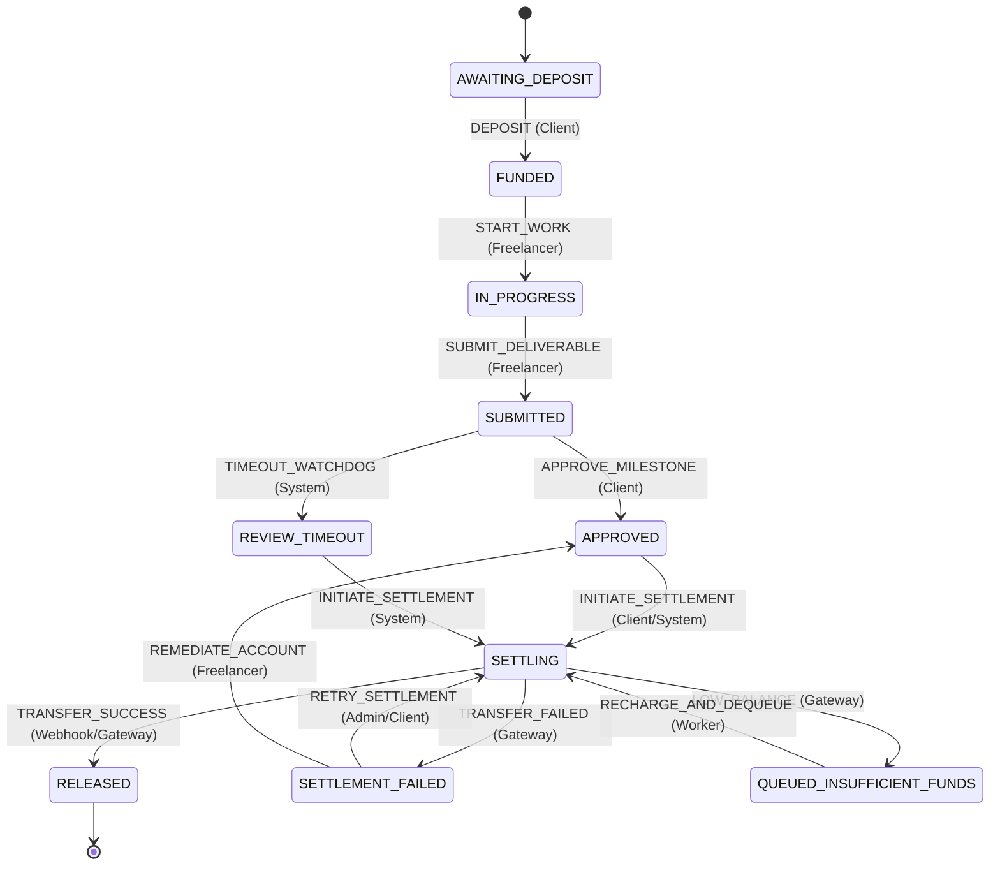

# Provider-Supported Settlement & Milestone Release Architecture

## 1. Executive Summary

This specification defines the production-ready architecture for **Provider-Supported Settlement & Milestone Release** in GigaFlow, transitioning from internal balance mutations to external financial execution backed by licensed Indian Payment Aggregator infrastructure (**Cashfree Easy Split & Payouts**).

---

## 2. Comparison: Simulated vs. Provider-Supported Release

### 2.1 Existing Simulated System
In the simulated environment (`src/core/engine-03-dbms/ledger.ts:160`):
1. **Trigger**: Client invokes milestone approval or release (`APPROVE_MILESTONE` or `RELEASE_ESCROW`).
2. **State Validation**: `milestone.status` in `['APPROVED', 'DISPUTED', 'REVIEW_TIMEOUT']`.
3. **Escrow Validation**: `contract.escrowBalance >= milestone.amount`.
4. **Synchronous Mutation**: Inside a single local `prisma.$transaction`:
   - Debits `contract.escrowBalance`: `decrement: milestone.amount`.
   - Credits freelancer wallet: `user.update({ where: { id: freelancerId }, data: { balance: { increment: amount } } })`.
   - Transitions milestone directly from `APPROVED` $\to$ `RELEASED`.
   - Inserts `EscrowTransaction` (`type: 'RELEASE'`, `status: 'COMPLETED'`).
   - Appends SHA-256 chained entry into `AuditLog`.

#### Architectural Limitations of Simulated Release:
- **Zero Banking Realism**: Balance increments are instant database writes without external bank clearing latency.
- **Float Rounding Hazards**: Uses JavaScript IEEE 754 `Float` values rather than integer paise.
- **Missing Fee Economics**: No platform commission deductions or tax withholding (GST/TDS).
- **Dual-Write Vulnerability**: External banking networks do not support distributed two-phase commit (2PC) with local SQLite databases.
- **No Liquidity Defense**: Assumes unlimited liquidity, ignoring gateway account float exhaustion.

---

### 2.2 Provider-Supported Architecture (Cashfree Rail)

```text
┌─────────────────────────────────────────────────────────────────────────────┐
│                       CLIENT APPROVAL & SETTLEMENT FLOW                     │
└─────────────────────────────────────────────────────────────────────────────┘
  Client clicks "Approve & Release"
               │
               ▼
  ┌────────────────────────────────────────────────────────┐
  │ Phase 1: Local State Reservation (ACID Transaction 1)  │
  │ • Acquire Mutex lock on milestoneId                    │
  │ • Verify freelancer verified Cashfree Beneficiary / ID │
  │ • Calculate 64-bit integer paise + 5% platform fee     │
  │ • Transition milestone: APPROVED -> SETTLING           │
  │ • Insert SettlementTransfer record (status: PENDING)   │
  │ • Append chained SHA-256 AuditLog (INITIATE_SETTLEMENT)│
  └────────────────────────────┬───────────────────────────┘
                               │
                               ▼ (Release Mutex)
  ┌────────────────────────────────────────────────────────┐
  │ Phase 2: Gateway Dispatch (NO DB LOCKS HELD)           │
  │ • POST /payout/v1/requestTransfer                      │
  │ • Parameters: beneId, amountPaise, transferId, mode    │
  └────────────────────────────┬───────────────────────────┘
                               │
            ┌──────────────────┴──────────────────┐
            ▼                                     ▼
     [Transfer Success / Webhook]        [Insufficient Float / Failure]
            │                                     │
            ▼                                     ▼
  ┌─────────────────────────────────┐   ┌─────────────────────────────────┐
  │ Phase 3a: Success Finalization  │   │ Phase 3b: Queuing / Remediation │
  │ (ACID Transaction 2)            │   │                                 │
  │ • Milestone -> RELEASED         │   │ If INSUFFICIENT_BALANCE:        │
  │ • Decrement escrowBalance       │   │ • Transfer -> QUEUED_FLOAT      │
  │ • EscrowTransaction (RELEASE)   │   │ • Milestone remains in SETTLING │
  │ • Activate next milestone       │   │ • Dispatch CRITICAL Admin Alert │
  │ • Chained AuditLog (RELEASED)   │   │ • Auto-dequeue worker on top-up │
  │ • SettlementTransfer -> SUCCESS │   │ If TRANSFER_FAILED:             │
  │                                 │   │ • Escrow stays 100% locked      │
  │                                 │   │ • Milestone reverts to APPROVED │
  │                                 │   │ • Alert admin for retry         │
  └─────────────────────────────────┘   └─────────────────────────────────┘
```

---

## 3. Freelancer Payout Method Onboarding

A freelancer cannot receive milestone disbursements without a cryptographically verified and KYC-validated payout profile linked to their user account:

1. **Beneficiary Profile Binding**:
   - `vendorId`: Unique Cashfree Beneficiary / Vendor identifier (e.g. `CF_BEN_981241`).
   - `accountType`: `BANK_ACCOUNT` (Account Number + IFSC) or `UPI` (Virtual Payment Address).
   - `accountIdentifier`: Masked display format (e.g. `••••9876` or `freelancer@okaxis`).
2. **Penny-Drop Verification**:
   - Automated ₹1.00 bank penny-drop or UPI VPA validation query via Cashfree verification endpoint.
   - Payout profile marked `VERIFIED` only upon successful name-match and active account confirmation.
3. **Immutability & Fraud Prevention**:
   - Payout methods cannot be modified while any contract is in `IN_PROGRESS`, `SUBMITTED`, or `SETTLING`.
   - Modifying payout details marks profile `PENDING` until re-verified.

---

## 4. Finite State Machine (FSM) Transitions



---

## 5. Mathematical Economics & Fee Deduction Model

All monetary transactions execute in **64-bit integer paise** ($1\text{ GF} = ₹1.00 = 100\text{ paise}$):

$$\text{Gross Amount (paise)} = \text{milestone.amount} \times 100$$
$$\text{Platform Commission (5\%)} = \text{round}(\text{Gross Amount} \times 0.05)$$
$$\text{Net Freelancer Disbursement} = \text{Gross Amount} - \text{Platform Commission}$$

### Canonical ₹100.00 Milestone Example:
- **Gross Milestone Value**: ₹100.00 (10,000 paise).
- **Platform Fee (5%)**: ₹5.00 (500 paise).
- **Net Freelancer Bank/UPI Transfer**: ₹95.00 (9,500 paise).
- **Escrow Deducted**: ₹100.00 (10,000 paise).
- **Invariant**: $\Delta \text{Escrow} (-10,000) + \Delta \text{Freelancer} (+9,500) + \Delta \text{PlatformFee} (+500) = 0$.

---

## 6. Failure Handling & Transfer Rejection (`TRANSFER_FAILED`)

If a transfer is rejected by the banking rail (e.g. invalid IFSC, beneficiary account frozen, bank network unreachable):

1. **Escrow Capital Protection**:
   - Contract escrow funds remain **$100\%$ untouched** inside `Contract.escrowBalance`. Under no circumstances are escrow funds debited or forfeited upon transfer rejection.
2. **State Reversion / Remediation**:
   - `SettlementTransfer.status` is marked `FAILED` with `failureCode` and `failureReason` recorded.
   - Milestone status transitions back to `APPROVED` (or `SETTLEMENT_FAILED`).
3. **Administrator Alerting**:
   - Real-time `WARNING` alert generated for ops and finance dashboard.
4. **Remediation & Retry**:
   - Freelancer can update their beneficiary payout method.
   - System administrator or client can safely re-trigger settlement with a fresh idempotency key (`idemp_{transferId}_retry_{n}`).

---

## 7. Insufficient Cashfree Payout Balance (Float Depletion)

### 7.1 Problem Description
In Indian Payment Aggregator architectures, outbound vendor transfers originate from an operational nodal **Payout Float Account**. If platform disbursement volume surges, the operational float balance may temporarily become insufficient to service outbound transfers.

### 7.2 Safety Invariant
- **Escrow Vault Untouched**: Client deposited funds reside securely in the RBI-regulated nodal escrow account.
- **Milestone Protection**: The milestone remains in `SETTLING` (funds locked from withdrawal or dispute).

### 7.3 Queuing Protocol & Administrator Alerting
1. **Immediate Detection**:
   - Gateway returns HTTP 400/409 with subcode `400` / `INSUFFICIENT_BALANCE` / `LOW_BALANCE`.
2. **Transfer Status**:
   - `SettlementTransfer.status` transitions to `QUEUED_INSUFFICIENT_FUNDS`.
   - `nextRetryAt` timestamp initialized with exponential backoff ($15\text{ min} \times 2^{\text{retryCount}}$).
3. **CRITICAL Alert Dispatch**:
   - PagerDuty/Slack/Email notification dispatched to Finance & Operations:
     ```text
     [CRITICAL ALERT] Cashfree Payout Float Depleted!
     - Required Transfer: ₹95.00 (9,500 paise)
     - Milestone ID: 91aeb317-d11e-4d28-8e85-a944b3d5a29b
     - Action Required: Top up Cashfree Payout Account via IMPS/NEFT virtual account.
     ```
4. **Append-Only Audit Log**:
   - Chained SHA-256 audit entry: `action: 'QUEUE_INSUFFICIENT_FLOAT'`, `newState: 'QUEUED_INSUFFICIENT_FUNDS'`.

### 7.4 Automated Float Dequeue Loop (`processQueuedSettlements`)
- Automated background worker runs on a 10-minute cadence:
  1. Queries operational float balance: `CashfreeGateway.getPayoutBalance()`.
  2. If `availableBalancePaise >= minimumThreshold`:
     - Selects queued transfers ordered strictly by **FIFO** (`createdAt ASC`).
     - Re-attempts transfer dispatch with incremented `retryCount`.
     - Upon confirmation, finalizes milestone release (`RELEASED`) and decrements escrow.

---

## 8. Webhook Security: HMAC-SHA256 & Replay Protection

Incoming webhooks (`POST /api/payments/webhook`) are cryptographically verified:
1. **HMAC-SHA256 Verification**:
   $$\text{Signature} = \text{Base64}\left(\text{HMAC-SHA256}\left(\text{timestamp} + \text{rawBody}, \text{CASHFREE\_WEBHOOK\_SECRET}\right)\right)$$
2. **Timing-Safe Comparison**:
   Executed via `crypto.timingSafeEqual` to eliminate side-channel timing attacks.
3. **300-Second Freshness Window**:
   Rejects any payload where $|\text{currentTime} - \text{timestamp}| > 300\text{ seconds}$, defeating replay attacks.
4. **Idempotency Guard**:
   Duplicate delivery of identical `transferId` or `gatewayTransferId` returns HTTP 200 without executing duplicate database mutations.
