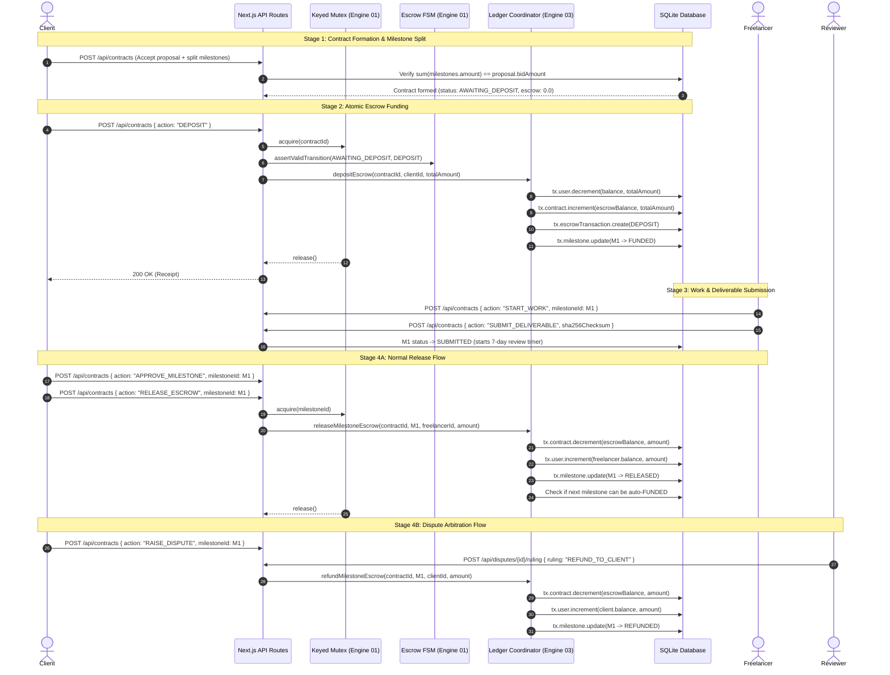

# Money-Bearing Fields and Transaction Flow Audit

**Document Version**: 1.0.0
**Date**: October 3, 2026
**Auditor**: Team 07 (KLE Technological University — Dept. of CSE)
**Target Repository**: GigaFlow (`/home/nethunter/Collage/BIG_PROJECT`)
**Scope**: Complete inventory of all money-bearing fields, models, mutation paths, arithmetic operations, and precision risks.

---

## 1. Executive Summary & Architectural Scope

This audit provides a comprehensive, ground-truth inventory of all monetary fields, currency types, transaction workflows, and mathematical operations across the GigaFlow codebase.

### Key Architectural Findings:
1. **100% Simulated Currency**:
   Per project constitution (`AGENTS.md` Section 4), real banking/payment gateways (Stripe, PayPal, UPI) are explicitly out-of-scope. All monetary values represent simulated currency units denominated in Indian Rupees (`₹`) within a closed-loop platform ledger.
2. **Decomposition of `escrow-engine.ts`**:
   Early specifications and architectural notes referenced `src/lib/escrow-engine.ts`. In the current production codebase, this engine has been formally partitioned across the **Four-Engine Architecture**:
   - **Engine 01 (OS Engine)**: `src/core/engine-01-os/escrow-fsm.ts` (FSM state legality) and `src/core/engine-01-os/watchdog.ts` (timeout watchdog scheduler).
   - **Engine 03 (DBMS Engine)**: `src/core/engine-03-dbms/ledger.ts` (atomic ACID double-entry balance coordinator) and `src/core/engine-03-dbms/contract-manager.ts` (milestone allocation, proposal conversion, dispute arbitration).
   - **Engine 04 (Web Engine)**: `src/app/api/contracts/route.ts`, `src/app/api/contracts/[id]/milestones/route.ts`, and `src/app/api/orders/route.ts`.
3. **Pervasive Floating-Point Representation**:
   Every monetary field in `prisma/schema.prisma` is currently typed as `Float` (mapping to SQLite 8-byte IEEE 754 `REAL`). In-memory calculations use native JavaScript double-precision arithmetic with manual epsilon workarounds (`Math.abs(split - bid) > 0.01`).

---

## 2. Prisma Schema Monetary Inventory (`prisma/schema.prisma`)

Below is the exhaustive inventory of all models in `prisma/schema.prisma` containing monetary or balance-related fields:

| Model | Field Name | DB Column | Prisma Type | SQLite Column Type | Default Value | Currency Unit | Nullable | Description & Invariant |
| :--- | :--- | :--- | :--- | :--- | :--- | :--- | :--- | :--- |
| **`User`** | `balance` | `balance` | `Float` | `REAL` | `0.0` | Simulated INR (`₹`) | No | User's simulated wallet balance. Must never be negative (`balance >= 0.0`). |
| **`Project`** | `budget` | `budget` | `Float` | `REAL` | *None (Required)* | Simulated INR (`₹`) | No | Maximum client budget proposed for the project. |
| **`Proposal`** | `bidAmount` | `bid_amount` | `Float` | `REAL` | *None (Required)* | Simulated INR (`₹`) | No | Freelancer's bid price to deliver the project scope. |
| **`Contract`** | `totalAmount` | `total_amount` | `Float` | `REAL` | *None (Required)* | Simulated INR (`₹`) | No | Total contract valuation, inherited from accepted `Proposal.bidAmount`. |
| **`Contract`** | `escrowBalance` | `escrow_balance` | `Float` | `REAL` | `0.0` | Simulated INR (`₹`) | No | Funds currently held in escrow custody for this contract. |
| **`Milestone`** | `amount` | `amount` | `Float` | `REAL` | *None (Required)* | Simulated INR (`₹`) | No | Payout allocated to this specific milestone upon release. |
| **`EscrowTransaction`** | `amount` | `amount` | `Float` | `REAL` | *None (Required)* | Simulated INR (`₹`) | No | Financial volume transferred in this immutable ledger entry. |
| **`Order`** | `amount` | `amount` | `Float` | `REAL` | *None (Required)* | Simulated INR (`₹`) | No | Fixed tier price for a direct marketplace gig order. |
| **`Gig`** | *(JSON in `tiers`)* | `tiers` | `String` | `TEXT` | *None (Required)* | Simulated INR (`₹`) | No | JSON array containing tiered packages: `{ name, price: number, deliveryDays, description }`. |

### Non-Monetary Numeric Fields in Schema (Excluded from Money Audit)
- `User.devScore`: `Int` (reputation score 0–100, default 50).
- `Milestone.sequenceOrder`: `Int` (1-indexed milestone ordering).
- `Proposal.aiMatchScore`: `Float` (heuristic Jaccard + budget score 0.0–100.0, default 0.0).

---

## 3. Money-Bearing Field Lifecycles and Mutation Paths

### 3.1 `User.balance`
- **Initial Source**:
  - Seed script (`prisma/seed.ts`): Client accounts seeded with ₹5,000.00 / ₹3,000.00; Freelancers seeded with ₹500.00 / ₹250.00.
  - User Registration (`POST /api/auth/register` via schema default): `0.0`.
- **Mutation Paths**:
  1. **Debit on Escrow Deposit**: `LedgerCoordinator.depositEscrow()` (`src/core/engine-03-dbms/ledger.ts:91-96`):
     ```typescript
     await tx.user.update({
       where: { id: input.clientId },
       data: { balance: { decrement: input.amount } }
     });
     ```
  2. **Credit on Escrow Release**: `LedgerCoordinator.releaseMilestoneEscrow()` (`src/core/engine-03-dbms/ledger.ts:206-211`):
     ```typescript
     await tx.user.update({
       where: { id: input.freelancerId },
       data: { balance: { increment: input.amount } }
     });
     ```
  3. **Credit on Escrow Refund**: `LedgerCoordinator.refundMilestoneEscrow()` (`src/core/engine-03-dbms/ledger.ts:315-320`):
     ```typescript
     await tx.user.update({
       where: { id: input.clientId },
       data: { balance: { increment: input.amount } }
     });
     ```
- **Atomicity & Locking**:
  Executed exclusively inside Prisma interactive ACID transactions (`prisma.$transaction`) with balance checks (`client.balance < input.amount`). Protected at the route layer by `globalKeyedMutex` on `contractId` or `milestoneId`.

### 3.2 `Contract.escrowBalance`
- **Initial Source**:
  - `ContractManager.createContractFromProposal()` (`src/core/engine-03-dbms/contract-manager.ts:96`): Initialized to `0.0` with status `AWAITING_DEPOSIT`.
- **Mutation Paths**:
  1. **Credit on Deposit**: `LedgerCoordinator.depositEscrow()` (`src/core/engine-03-dbms/ledger.ts:99-105`):
     ```typescript
     await tx.contract.update({
       where: { id: input.contractId },
       data: {
         escrowBalance: { increment: input.amount },
         status: 'FUNDED'
       }
     });
     ```
  2. **Debit on Release**: `LedgerCoordinator.releaseMilestoneEscrow()` (`src/core/engine-03-dbms/ledger.ts:198-203`):
     ```typescript
     await tx.contract.update({
       where: { id: input.contractId },
       data: { escrowBalance: { decrement: input.amount } }
     });
     ```
  3. **Debit on Refund**: `LedgerCoordinator.refundMilestoneEscrow()` (`src/core/engine-03-dbms/ledger.ts:307-312`):
     ```typescript
     await tx.contract.update({
       where: { id: input.contractId },
       data: { escrowBalance: { decrement: input.amount } }
     });
     ```
- **Invariants**:
  - Non-negative: `escrowBalance >= 0.0`.
  - Conservation: $\Delta \text{Escrow} + \Delta \text{Client/Freelancer} = 0$.

### 3.3 `Project.budget` & `Proposal.bidAmount`
- **Initial Source**:
  - `Project.budget`: Created via `POST /api/projects` validated by `createProjectSchema` (`z.number().positive()`).
  - `Proposal.bidAmount`: Created via `POST /api/proposals` validated by `submitProposalSchema` (`z.number().positive()`).
- **Mutation Path**:
  - Immutable once submitted; proposals can be updated prior to contract formation via proposal upsert in `POST /api/proposals`.
  - Read by `HeuristicSemanticMatcher.calculateMatchScore()` (`src/core/engine-02-dsa-se/matcher.ts`) to compute bid-to-budget fit ratio:
    $$\text{budgetRatio} = \frac{\text{bidAmount}}{\text{budget}}$$

### 3.4 `Milestone.amount`
- **Initial Source**:
  - Created during contract formation in `ContractManager.createContractFromProposal()` (`src/core/engine-03-dbms/contract-manager.ts:102-115`).
- **Validation**:
  - Enforces that the sum of milestone amounts equals the accepted `Proposal.bidAmount` within $\pm 0.01$:
    $$\left| \sum_{i=1}^{n} \text{milestone}_i.\text{amount} - \text{bidAmount} \right| \le 0.01$$
- **Mutation Path**:
  - Immutable after contract formation. Dictates the exact payout on milestone release or client refund.

### 3.5 `EscrowTransaction.amount`
- **Initial Source & Mutation**:
  - Append-only ledger record created on every `DEPOSIT`, `RELEASE`, or `REFUND` action inside `LedgerCoordinator`.
  - Immutable once committed to the database.

### 3.6 `Order.amount` & `Gig.tiers`
- **Initial Source**:
  - `Gig.tiers`: JSON serialized in `POST /api/gigs` (validated by `createGigSchema`, where `price: z.number().positive()`).
  - `Order.amount`: Created in `POST /api/orders` from `placeOrderSchema` (`amount: z.number().positive()`).
- **Current Mutation Behavior**:
  - **Gap Detected**: In `src/app/api/orders/route.ts`, gig orders record `amount` and create an `Order` row, but **do not deduct client balance or interact with the Escrow Coordinator**. It acts as an unbonded catalog order.

---

## 4. End-to-End Money Flow Lifecycle



---

## 5. Floating-Point Arithmetic Inventory & Locations

The following table documents every line of code where arithmetic or floating-point manipulation is performed on monetary values:

| File Path | Line(s) | Code Snippet | Operation Type | Precision Risk / Behavior |
| :--- | :--- | :--- | :--- | :--- |
| `src/core/engine-03-dbms/ledger.ts` | 65 | `if (client.balance < input.amount)` | Comparison (`<`) | Safe comparison, but IEEE 754 rounding could cause false negatives if balance has accumulated fractionals. |
| `src/core/engine-03-dbms/ledger.ts` | 78 | `if (contract.status === 'FUNDED' \|\| contract.escrowBalance > 0)` | Comparison (`>`) | Equality check against zero. If float underflows to `1e-17`, this evaluates to `true`. |
| `src/core/engine-03-dbms/ledger.ts` | 94 | `balance: { decrement: input.amount }` | Prisma Decrement | SQLite executes `balance = balance - ?`. Can introduce IEEE 754 precision drift (e.g. `0.30000000000000004`). |
| `src/core/engine-03-dbms/ledger.ts` | 102 | `escrowBalance: { increment: input.amount }` | Prisma Increment | SQLite executes `escrow_balance = escrow_balance + ?`. Precision accumulation risk over multiple deposits. |
| `src/core/engine-03-dbms/ledger.ts` | 172 | `if (contract.escrowBalance < input.amount)` | Comparison (`<`) | Float comparison. |
| `src/core/engine-03-dbms/ledger.ts` | 201 | `escrowBalance: { decrement: input.amount }` | Prisma Decrement | Debit escrow float. |
| `src/core/engine-03-dbms/ledger.ts` | 209 | `balance: { increment: input.amount }` | Prisma Increment | Credit freelancer wallet float. |
| `src/core/engine-03-dbms/ledger.ts` | 231 | `if (nextMilestone && updatedContract.escrowBalance >= nextMilestone.amount)` | Comparison (`>=`) | Sequential milestone activation condition. Float inaccuracies could prevent valid sequential progression. |
| `src/core/engine-03-dbms/ledger.ts` | 302 | `if (contract.escrowBalance < input.amount)` | Comparison (`<`) | Refund threshold comparison. |
| `src/core/engine-03-dbms/ledger.ts` | 310 | `escrowBalance: { decrement: input.amount }` | Prisma Decrement | Debit escrow float on refund. |
| `src/core/engine-03-dbms/ledger.ts` | 318 | `balance: { increment: input.amount }` | Prisma Increment | Credit client wallet float on refund. |
| `src/core/engine-03-dbms/ledger.ts` | 349 | `if (updatedContract.escrowBalance <= 0)` | Comparison (`<=`) | Zero-balance contract completion trigger. Fails if float residual remains (`0.0000000001`). |
| `src/core/engine-03-dbms/contract-manager.ts` | 82 | `const totalSplit = input.milestones.reduce((acc, m) => acc + m.amount, 0);` | Accumulation (`+`) | Standard JS float summation accumulator. Vulnerable to binary representation error (e.g. `0.1 + 0.2 != 0.3`). |
| `src/core/engine-03-dbms/contract-manager.ts` | 83 | `if (Math.abs(totalSplit - proposal.bidAmount) > 0.01)` | Delta & Epsilon (`-`, `>`) | **Direct Epsilon Workaround**: Developers added a `0.01` threshold specifically because `Float` additions failed exact equality (`totalSplit !== proposal.bidAmount`). |
| `src/core/engine-02-dsa-se/matcher.ts` | 59 | `const budgetRatio = project.budget > 0 ? proposal.bidAmount / project.budget : 0.0;` | Division (`/`) | Bid-to-budget ratio computation. |
| `src/core/engine-02-dsa-se/matcher.ts` | 63 | `const deviation = Math.abs(budgetRatio - 1.0);` | Subtraction (`-`) | Budget deviation metric. |
| `src/core/engine-02-dsa-se/matcher.ts` | 64 | `budgetScore = Math.max(0.0, 100.0 - deviation * 100.0);` | Multiplication & Subtraction (`*`, `-`) | Budget score scaling. |
| `src/core/engine-02-dsa-se/matcher.ts` | 66 | `budgetScore = Number(budgetScore.toFixed(2));` | Formatting (`.toFixed`) | String conversion to 2 decimal places. |
| `src/core/engine-02-dsa-se/matcher.ts` | 73–75 | `0.5 * skillScore + 0.3 * budgetScore + 0.2 * reputationScore` | Linear Combination | Weighted score float calculation. |
| `src/app/dashboard/page.tsx` | 376 | `const formatRupee = (amount: number) => '₹' + amount.toFixed(2);` | Formatting (`.toFixed`) | Presentation layer string formatting. |
| `src/app/dashboard/page.tsx` | 377 | `const totalProtected = contracts.reduce((sum, c) => sum + c.escrowBalance, 0);` | Accumulation (`+`) | Client-side UI float reduction. |
| `src/app/projects/page.tsx` | 74, 121 | `projects.filter(p => p.budget >= 2500)` | Comparison (`>=`) | UI filter threshold. |
| `src/app/projects/page.tsx` | 107, 152 | `₹{project.budget.toFixed(2)}` | Formatting (`.toFixed`) | Presentation layer string formatting. |
| `src/app/disputes/page.tsx` | 122 | `₹{dispute.milestone.amount.toFixed(2)}` | Formatting (`.toFixed`) | Presentation layer string formatting. |
| `src/lib/errors.ts` | 77, 87 | `available.toFixed(2), required.toFixed(2)` | Formatting (`.toFixed`) | Error string formatting. |
| `tests/engine-03-dbms/ledger.test.ts` | 92–94 | `const deltaClient = updatedClient!.balance - preClientBalance; ... expect(deltaClient + deltaEscrow).toBe(0.0);` | Invariant Verification | Net-zero balance conservation test. |

---

## 6. Vulnerability & Risk Assessment

### 6.1 IEEE 754 Floating-Point Drift
- **Mechanism**: SQLite and JavaScript utilize IEEE 754 double-precision floating-point numbers. Certain base-10 fractional values cannot be represented exactly in base-2 binary floating point (e.g. `0.1` and `0.2`).
- **Observed Manifestation**: In `contract-manager.ts:83`, the team was already forced to implement `Math.abs(totalSplit - proposal.bidAmount) > 0.01` rather than strict equality due to precision errors during milestone split validation.
- **Risk**: Over hundreds of micro-transactions, small fractions of simulated rupees can be created or lost, breaking strict mathematical conservation invariants.

### 6.2 Zero-Equality State Bypass
- **Mechanism**: In `src/core/engine-03-dbms/ledger.ts:349`:
  ```typescript
  if (updatedContract.escrowBalance <= 0) {
    await tx.contract.update({
      where: { id: input.contractId },
      data: { status: 'REFUNDED' },
    });
  }
  ```
  If consecutive deductions leave an infinitesimal remainder (e.g. `1e-16`), a contract might never transition to `REFUNDED` or might satisfy `escrowBalance > 0` checks prematurely.

### 6.3 Unbonded Marketplace Orders
- **Mechanism**: In `src/app/api/orders/route.ts:77-89`, when a client places an order for a gig tier, an `Order` row is created with `amount`, but the client's `User.balance` is **never checked and never debited**.
- **Risk**: Clients can place infinite orders with zero balance, bypassing the escrow protection mechanism that safeguards normal milestone contracts.

---

## 7. Migration Recommendations (Roadmap to Integer Subunits)

To eliminate floating-point risks and elevate the repository to institutional financial grade:

1. **Adopt Integer Subunits (Paise)**:
   - In SQLite and Prisma, convert all monetary `Float` fields to `Int` (or `BigInt`).
   - Store all values in the smallest currency subunit (**Paise**: ₹1.00 = 100 paise).
   - Example: A ₹1,200.50 budget is stored in the database as integer `120050`.
2. **Schema Migration Plan**:
   ```prisma
   model User {
     balance Int @default(0) // Stored in paise
   }
   model Contract {
     totalAmount   Int       // Stored in paise
     escrowBalance Int @default(0) // Stored in paise
   }
   model Milestone {
     amount Int             // Stored in paise
   }
   ```
3. **Integer Arithmetic**:
   - `totalSplit = input.milestones.reduce((acc, m) => acc + m.amount, 0)` becomes exact integer addition.
   - Exact equality `totalSplit === proposal.bidAmount` becomes possible with zero epsilon drift.
4. **Display Layer Utility**:
   - Create a centralized currency formatter:
     ```typescript
     export function formatPaiseToRupee(paise: number): string {
       return `₹${(paise / 100).toFixed(2)}`;
     }
     ```
5. **Gig Order Escrow Integration**:
   - Update `POST /api/orders` to execute atomic balance verification and debit via `LedgerCoordinator`.

---

*Authored by Team 07 Engineering Squad for KLE Technological University CSE Capstone / Major Project.*
