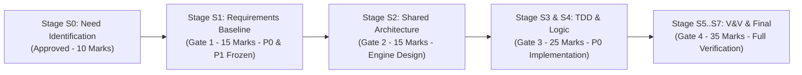

# Prioritized Requirements Specification (MoSCoW Matrix)

> **Academic Milestone**: Stage S1 — Requirements Engineering Baseline (Gate 1 Deliverable 6)
> **Institution**: KLE Technological University (Dr. M. S. Sheshgiri College of Engineering & Technology, Belagavi) — Dept. of CSE
> **Curriculum Framework**: Engine-Based Mini-Project Framework with Hybrid SDLC
> **Team**: Team 07 (Theme 01)
> **Project Title**: Milestone-Based Escrow & Evidence-Based Dispute Resolution Workflow
> **Authoritative References**: `docs/source-material/Mini_Project_Gate_0_details_FILLED.docx` (Step 4, Item 2), `docs/source-material/Team07_Escrow_Mini_Project_KLE_Theme.pptx` (Slides 18 & 19), `docs/requirements/functional-requirements.md`, `docs/requirements/non-functional-requirements.md`.

---

## 1. Executive Summary & Prioritization Framework

To maximize engineering velocity, manage academic constraints (15 weeks, 4 developers, zero budget), and guarantee that core computer science mechanisms are verified first, Team 07 has established a formal **MoSCoW Prioritization Framework**:

- **Must Have (P0 — Crucial / Non-Negotiable)**: Core functionality required to solve the primary problem statement. If any P0 requirement is missing, the system cannot demonstrate the core escrow and evidence-based dispute resolution lifecycle.
- **Should Have (P1 — High Priority / Important)**: Critical supporting mechanisms that ensure system security, automated workflow progression, and empirical verifiability.
- **Could Have (P2 — Medium Priority / Desirable)**: Advanced enhancements (e.g. AI proposal matching heuristics, real-time UI polling) that enrich usability without compromising core escrow integrity.
- **Won't Have (P3 — Out-of-Scope for S1 Baseline)**: Explicitly excluded features (e.g. real banking custodial wallets, autonomous legal AI arbitration, native mobile iOS/Android apps) to prevent scope creep.

---

## 2. Functional Requirements Prioritization (FR-01 to FR-12)

| Req ID | Requirement Title | MoSCoW Tier | Priority | Owning Engine & Student Owner | Complexity | Academic & Architectural Justification |
| :--- | :--- | :---: | :---: | :--- | :---: | :--- |
| **FR-01** | **Escrow Fund Locking** | **Must Have** | **P0** | **Engine 01 (OS Engine)** Vaishnavi Modekar | High (8 SP) | **Core S0 Need**: Eliminates client payment default. Funds must be locked before freelancer begins work. Prevents double-allocation race conditions. |
| **FR-02** | **Milestone State Tracking** | **Must Have** | **P0** | **Engine 01 (OS Engine)** Vaishnavi Modekar | Med (5 SP) | **Core S0 Need**: Enforces deterministic FSM state progression (`AWAITING_DEPOSIT` $\to$ `FUNDED` $\to$ `IN_PROGRESS` $\to$ `UNDER_REVIEW` $\to$ `RELEASED`). Rejects illegal state jumps. |
| **FR-03** | **Cryptographic SHA-256 Checksums** | **Must Have** | **P0** | **Engine 02 (DSA & SE Engine)** Darshan Kittur | Med (5 SP) | **Core S0 Need**: Establishes mathematical proof of deliverable integrity and non-repudiation. Guarantees 100% tamper detection upon dispute inspection. |
| **FR-05** | **ACID Payment Ledger Processing** | **Must Have** | **P0** | **Engine 03 (DBMS Engine)** Purvi Sammatshetti | High (8 SP) | **Core S0 Need**: Guarantees zero balance discrepancy and double-spend protection through atomic SQLite write transactions (`$\sum \Delta B = 0$`). |
| **FR-06** | **Tamper-Resistant Audit Log** | **Must Have** | **P0** | **Engine 03 (DBMS Engine)** Purvi Sammatshetti | Med (5 SP) | **Core S0 Need**: Provides immutable chronological auditability for all state transitions, financial movements, and dispute rulings with SHA-256 verification chains. |
| **FR-07** | **Role-Based Workflow Dashboards** | **Must Have** | **P0** | **Engine 04 (Web Engine)** Vaibhav Chavanpatil | High (8 SP) | **Core S0 Need**: Delivers distinct user interfaces for Clients, Freelancers, Dispute Arbiters, and Administrators to interact with platform contracts and milestones. |
| **FR-08** | **Authentication & Server-Side RBAC** | **Must Have** | **P0** | **Engine 04 (Web Engine)** Vaibhav Chavanpatil | Med (5 SP) | **Core Security**: Protects 100% of internal endpoints and operations using server-side session tokens, strictly isolating roles (Client cannot adjudicate own dispute). |
| **FR-04** | **Tamper-Evident Evidence Trees** | **Should Have** | **P1** | **Engine 02 (DSA & SE Engine)** Darshan Kittur | High (8 SP) | **Essential Dispute Resolution**: Models the causal timeline of deliverables, rejections, and counter-claims as an N-ary tree with $O(V+E)$ traversal for arbiters. |
| **FR-09** | **Dispute Escalation Workflow** | **Should Have** | **P1** | **Engine 04 (Web Engine)** Vaibhav Chavanpatil | Med (5 SP) | **Structured Arbitration**: Provides multi-step dispute filing forms, evidence upload wizards, and neutral Arbiter adjudication consoles. |
| **FR-12** | **Contract Lifecycle Orchestration** | **Should Have** | **P1** | **Engine 01 (OS Engine)** Vaishnavi Modekar | Med (5 SP) | **Phase Automation**: Orchestrates sequential milestone progression ($m_{k} \to m_{k+1}$) and terminates contracts upon full completion or refund. |
| **FR-10** | **Real-Time FSM State UI (5s Poller)**| **Could Have** | **P2** | **Engine 04 (Web Engine)** Vaibhav Chavanpatil | Low (3 SP) | **UX Polish**: Synchronizes client and freelancer screens every 5 seconds to display live milestone transitions without full browser reloads. |
| **FR-11** | **Semantic AI Proposal Matcher** | **Could Have** | **P2** | **Engine 02 (DSA/SE Primary)** **Engine 03 (DBMS Supporting)** | Med (5 SP) | **Marketplace Efficiency**: Uses Jaccard tag similarity and developer scoring heuristics to objectively rank incoming proposals for clients. |

---

## 3. Non-Functional Requirements Prioritization (NFR-01 to NFR-10)

| NFR ID | Quality Attribute Category | MoSCoW Tier | Measurable KPI Target | Verification Strategy | Owning Engine |
| :--- | :--- | :---: | :--- | :--- | :--- |
| **NFR-02** | **Security & Access Control** | **Must Have (P0)** | **100% of protected routes** enforce server-side RBAC | Automated HTTP 401/403 negative permission test suite | **Engine 04 (Web)** |
| **NFR-03** | **Data & Deliverable Integrity**| **Must Have (P0)** | **100% detection rate** for file tampering or hash mismatch | Byte-level injection corruption test on deliverable stream | **Engine 02 (DSA/SE)** |
| **NFR-05** | **FSM Reliability** | **Must Have (P0)** | **0 invalid or out-of-order state transitions** permitted | Automated state transition matrix fuzzer | **Engine 01 (OS)** |
| **NFR-08** | **Financial Consistency** | **Must Have (P0)** | **0 double-allocation or balance discrepancy anomalies** | Concurrent stress test suite asserting $\sum \Delta B = 0$ | **Engine 03 (DBMS)** |
| **NFR-04** | **Input Sanitization** | **Must Have (P0)** | **100% of payloads** validated via Zod 4 runtime schemas | Automated boundary fuzzing against SQLi and XSS payloads | **All Engines** |
| **NFR-09** | **Auditability & Traceability** | **Should Have (P1)** | **100% of state transitions** logged with verification hash | Audit log reconciliation and cryptographic chain verification | **Engine 03 (DBMS)** |
| **NFR-01** | **API Response Performance** | **Should Have (P1)** | **p95 latency $\le 500\text{ ms}$** across core endpoints | Load test suite (50 concurrent requests, 100 projects) | **All Engines** |
| **NFR-07** | **Modular Maintainability** | **Should Have (P1)** | **4 independently testable engine modules**; 100% RTM | Static architecture linting and RTM completeness test | **Engine 02 (DSA/SE)** |
| **NFR-06** | **UI Viewport Responsiveness** | **Could Have (P2)** | **Responsive rendering** across 360px–1920px (Lighthouse $\ge 90$) | Playwright cross-device viewport regression tests | **Engine 04 (Web)** |
| **NFR-10** | **Fault Tolerance & Envelopes** | **Could Have (P2)** | **Zero unhandled 500 crashes**; standardized JSON errors | Fault injection tests asserting structured error JSON responses | **All Engines** |

---

## 4. Out-of-Scope Items (Won't Have — P3)

The following capabilities are formally bounded and excluded from the academic baseline to prevent scope creep:

1. **Direct Real-Money Banking Custody**: No direct deposit accounts held in college/student bank accounts; operates strictly with simulated platform currency (or non-custodial sandbox payment gateway per approved Scope Amendment).
2. **Autonomous Legal AI Court Arbitration**: Artificial Intelligence does not make unilateral, binding dispute decisions. Human dispute reviewers adjudicate cases using the structured evidence tree.
3. **Native iOS and Android Mobile Apps**: Mobile support is achieved through responsive Web UI (Tailwind CSS breakpoints), avoiding duplicated codebase maintenance.
4. **Unlimited Video File Streaming**: File uploads are capped at 50 MB per artifact; raw video editing storage is not supported.
5. **Corporate Taxation & Automated Invoicing**: Complex enterprise GST/VAT calculation modules are excluded from the academic scope.

---

## 5. Implementation Roadmap by Academic Gate

- **Gate 1 Focus**: Lock in all **Must Have (P0)** and **Should Have (P1)** specifications with verifiable acceptance criteria, engine boundaries, and formal RTM traceability.
